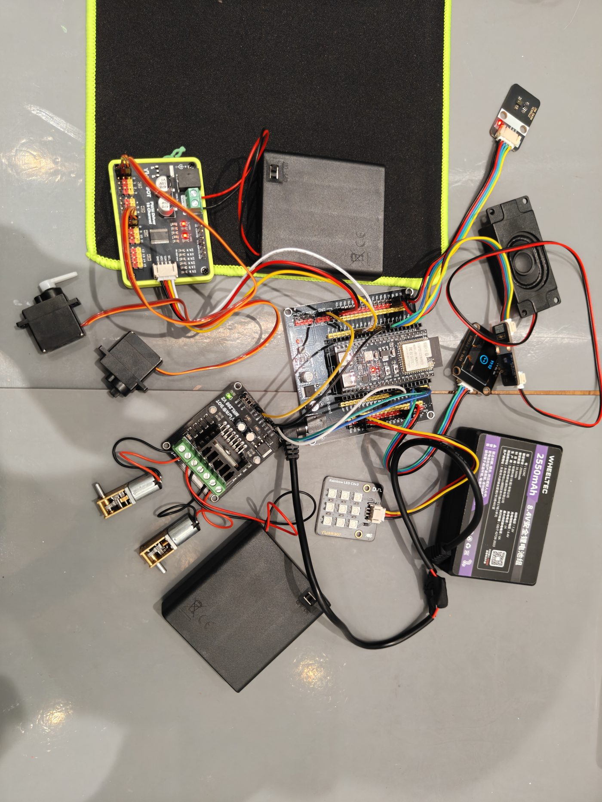

# 小智 AI DIY —— 零基础入门教程：从彩灯到舵机（详细图文说明，包含原理以及踩过的坑）



*整套东西摊开在桌上的样子。认一下：中间那块绿色扩展板上插着的是 **ESP32-S3 主控**；左上黄绿边框的是 **PCA9685 舵机驱动板**；左下黑色的是 **电机驱动板**；右边红黑色方块是 **喇叭**；中间偏下那块白色方形是 **3×3 彩灯板**；右下是 **8.4V 电池**；两个金色小圆柱是 **N20 减速电机**；黑色小方块和蓝色小舵机就是 **舵机**。*

---

## 这是什么

全部代码可运行，全部接线经过实测，全部坑都记录在案。

你说"彩虹流水灯，速度 8"，板子上的 9 颗灯珠真的会跑起来。从这句话到灯亮，在固件里是这样走的：

```
你的声音 → 麦克风 → 云端识别 → 大模型
                                  ↓ 决定调用 self.light.set_effect(flow, 8, rainbow)
                             MCP 协议下发到板子
                                  ↓
                             工具回调改状态变量
                                  ↓
                             后台任务 30fps 渲染 → RMT 输出 → 灯珠亮了
```

**理解这条链路，是这套教程唯一的学习目标。** 灯、电机、舵机只是三种不同的"动作执行方式"，学会一种，其余的照着套。

---

## 能力与边界（先说清楚）

| 能做到 | 做不到 |
|---|---|
| 语音控制灯效、颜色、亮度 | ❌ 主动说话（只能应答，或播内置音效） |
| 语音控制电机正反转、调速、转向 | ❌ 离线使用（识别在云端） |
| 语音控制 11 路舵机（代码预留；实物接了 4 个：1 个 180° + 3 个 360°） | ❌ 人脸识别（没摄像头，算力也不够） |
| 屏幕显示表情和字幕 | ❌ 超过 32 个语音工具（服务端硬限） |

---

## 教程目录

| 章节 | 内容 | 适合谁 |
|---|---|---|
| [01-环境与接线](教程/01-环境与接线.md) | IDF 安装、烧录、VSCode 配置、**完整引脚表**、分模块接线、供电 | 所有人，必读 |
| [02-代码结构与改动清单](教程/02-代码结构与改动清单.md) | 改了哪些文件、一行创建的原理、**MCP 工具机制**、32 上限与合并 | 想改造的人，必读 |
| [03-彩灯板](教程/03-彩灯板.md) | WS2812 原理、RMT、8 种特效算法、彩虹、亮度叠加 | 想学灯效 |
| [04-直流电机与差速控制](教程/04-直流电机与差速控制.md) | H 桥、MRL298 V2 / ZK-BM1 驱动板、LEDC、28% 起步补偿、差速转向 | 想学运动控制 |
| [05-舵机与 PCA9685](教程/05-舵机与PCA9685.md) | 舵机 PWM、PCA9685 寄存器、预分频计算、I2C 扩展 | 想学总线与外设扩展 |
| [06-踩坑与排查](教程/06-踩坑与排查.md) | 故障定位流程图 + 21 条实测问题 | 遇到问题先查这本 |
| 07-拓展指南 | 加舵机/电机/灯板/传感器，各改几行；工具与引脚不够怎么办 | 想做新项目 |
| 08-教学使用指南与PPT大纲 | 课时安排、34 页 PPT 大纲、演示脚本、学生常见问题 | 老师/要做分享的人 |

**完整源码副本**：[`代码/`](代码/) 目录（5 个文件，与工程实际代码一致）

---

## 三条学习路径

**① 只想跑通（半天）**
`01` → 烧录 → 能对话 → 完事

**② 想懂原理（2~3 天）**
`01` → `02` → 按兴趣挑 `03`/`04`/`05`

**③ 想改造（先读这两章）**
`02`（尤其 2.7 工具数限制）→ `07` 拓展指南

> ⚠️ `03`/`04`/`05` 是**并列关系**，不是递进关系。不用按顺序读。

---

## 快速开始（6 步）

```powershell
# 1. 在 PowerShell 窗口里激活 ESP-IDF（cmd 里不行；每个新窗口都要做一次）
#    报"禁止运行脚本"时，先执行：Set-ExecutionPolicy -Scope Process -ExecutionPolicy Bypass
C:\Espressif\tools\Microsoft.v6.1.PowerShell_profile.ps1

# 2. 进工程
cd <你的 xiaozhiAI-diy>\xiaozhi-diy\xiaozhi-esp32

# 3. 把本项目代码放进工程（只需做一次；新 clone 的官方仓库必须做，否则编出来只能对话）
#    把 DIY-notes\代码\ 里的 5 个文件拷进 main\boards\bread-compact-wifi\
#      3 个新增：led_strip_controller.h / dc_motor_controller.h / pca9685_servo.h
#      2 个覆盖：config.h / compact_wifi_board.cc
#    细节见 01 章 1.1

# 4. 选板型（只需做一次）
idf.py menuconfig
#    → Xiaozhi Assistant → Target Board → Bread Compact Wi-Fi (面包板)
#    → 再回 Xiaozhi Assistant → OLED Type → SSD1306 128*64
#      （默认是 128*32，不改的话屏幕只显示上半屏，见 06 章 B3）

# 5. 编译
idf.py build

# 6. 烧录 + 看日志（COM 口号以设备管理器为准）
idf.py -p COM15 -b 115200 flash monitor
```

**成功标志**：串口出现这几行（顺序就是实际顺序）

```
Servo:     PCA9685 @0x40  SDA9/SCL10  11 路  50Hz(prescale 121) · 就绪
Servo:       1号 → 通道0  180°角度  500~2500us
Servo:       2号 → 通道1  180°角度  500~2500us
             …（3 号~8 号，通道 2~7，格式相同）
Servo:       9号 → 通道8  360°调速  500~2500us
Servo:      10号 → 通道9  360°调速  500~2500us
Servo:      11号 → 通道10  360°调速  500~2500us
LedStrip:  彩灯板(light) on GPIO21, 9 leds active (buffer 64)
Motor:     1号电机(motor1) IN-IN GPIO1/2, LEDC ch7/6
Motor:     2号电机(motor2) IN-IN GPIO38/18, LEDC ch5/4 inverted
```

> 舵机那行写 **11 路**，是因为代码通道表预留了 11 个位置（通道 0~10）；**实物只插了 4 个**（1 号 + 9/10/11 号），空着的通道照样会打印，所以看到 11 行明细是正常的。

> **烧完还不会说话？** 第一次开机要**配网（连 WiFi）**，不配它就一直在等，日志正常但不对你应答。步骤见 [01 章 1.4 末尾](教程/01-环境与接线.md)。

---

## 硬件一览

| 模块 | 型号 | 关键引脚 |
|---|---|---|
| 主控 | ESP32-S3-WROOM-1 **N16R8** | — |
| 麦克风 | ZTS6631（I2S） | 4 / 5 / 6 |
| 功放 | NS4168 + 喇叭 | 7 / 15 / 16 |
| 屏幕 | 0.96" OLED 128×64（SSD1306/1315） | 41 / 42（I2C0, 0x3C） |
| 彩灯板 | WS2812B 3×3 = 9 颗 | 21（RMT） |
| 舵机驱动 | PCA9685 16 路 | 9 / 10（I2C1, 0x40） |
| 舵机 | MG90S 180° ×1（推荐满配 8 个）+ MG945 360° ×3 | PCA9685 CH0、CH8~CH10 |
| 电机 | N20 ×2 + MRL298 V2 驱动板 | 1/2、38/18 |
| 按键 | BOOT / 触摸 / 音量± | 0 / 47 / 40 / 39 |

**空闲引脚**：`8` `11` `12` `13` `14` `17`（详细建议用途见 1.7）
**禁用引脚**：`3` `45` `46`（strapping）、`43` `44`（串口日志）

完整表格与接线图见 [01 章](教程/01-环境与接线.md)。

---

## 当前状态

| 项 | 值 |
|---|---|
| 固件版本 | xiaozhi-esp32 **v2.5.2** |
| ESP-IDF | **v6.1** |
| 编译产物 | `xiaozhi.bin` 约 2.5MB，分区剩余 37% |
| 语音工具 | **21 / 32**（自建 19 + 系统 2），还剩 11 个名额 |
| 已验证 | 灯板、两个电机、4 个舵机（1 个 180° + 3 个 360°） |
| 未实现 | 微动开关、超声波传感器（引脚已预留） |

### 三个必须知道的约束

1. **工具数上限 32**，是服务端限制，改代码没用。
2. **ESP32-S3 只有 8 个 LEDC 通道**：2 个电机占掉 4 个（ch4~7），剩下 ch0~3 目前空着，理论上还能再挂 2 个电机；但满配 8 个舵机要 8 个通道，和电机一起就超了。所以舵机走 PCA9685（I2C）。
3. **舵机必须独立供电**。满配 8 个 MG90S 的理论峰值约 5.6A（8×700mA）；本项目实物只接 4 个，实测没触发过 brownout，但舵机那点电流不能和主板挤在一路，所以实物给舵机单独一组 4 节干电池。

---

## 目录结构

本目录位于 `<你的 xiaozhiAI-diy>\DIY-notes\`，和工程目录 `xiaozhi-diy\` **并列**，不在工程内部——所以备份/分发教程时只拷这一个文件夹，不会连带几十 MB 的 build 目录。

```
xiaozhiAI-diy\
├── DIY-notes\                 ← 本教程（独立，可单独打包）
└── xiaozhi-diy\xiaozhi-esp32\ ← 实际工程源码
```

```
DIY-notes/
├── README.md                  ← 你在这里
├── 教程/
│   ├── 01-环境与接线.md
│   ├── 02-代码结构与改动清单.md
│   ├── 03-彩灯板.md
│   ├── 04-直流电机与差速控制.md
│   ├── 05-舵机与PCA9685.md
│   ├── 06-踩坑与排查.md
│   ├── 07-拓展指南.md
│   └── 08-教学使用指南与PPT大纲.md
└── 代码/                      ← 5 个源文件副本（与工程一致）
```

---
*最后更新：2026-11-23　|　与工程代码同步*
