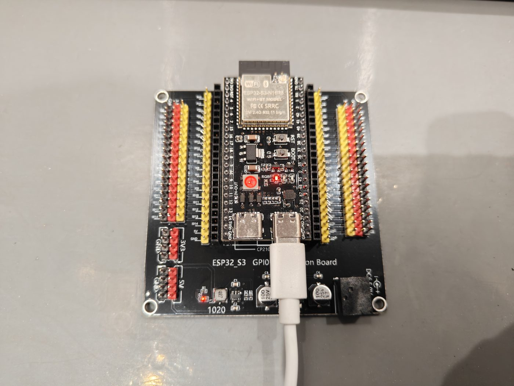
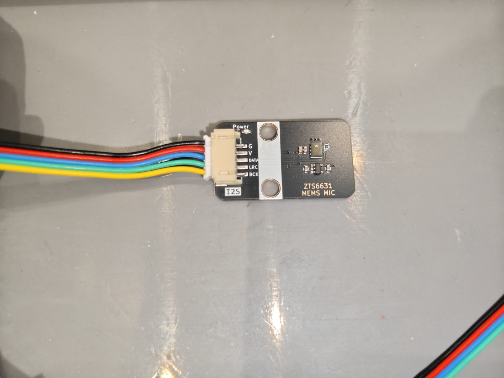
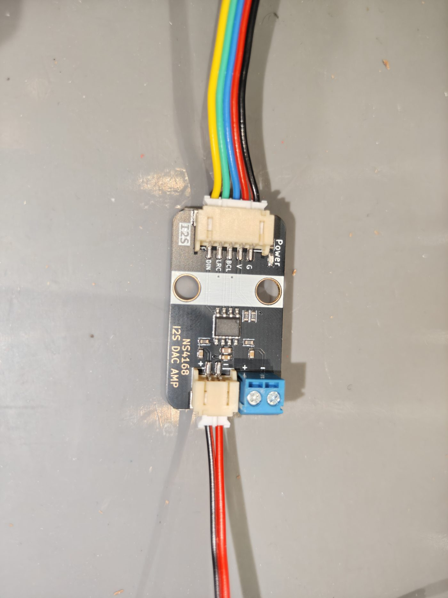
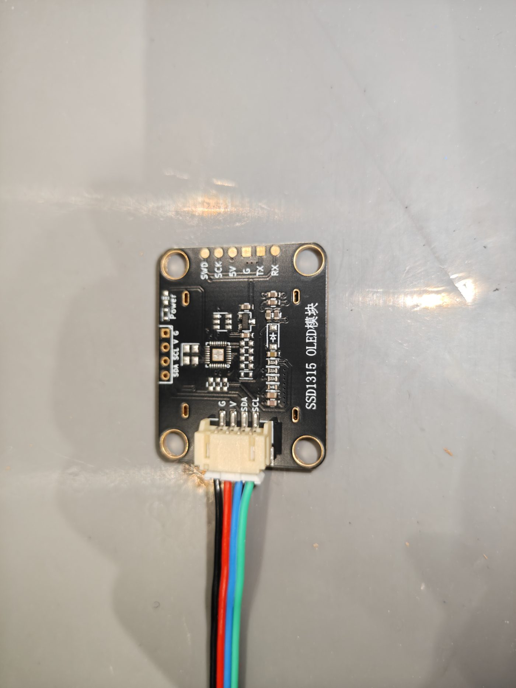
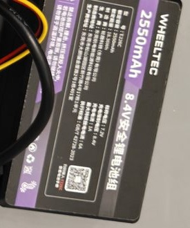

# 第一章　环境搭建与硬件接线

> 这一章做完，你应该能做到：编译通过、烧录成功、屏幕亮起来、能和小智对话。
> 还不涉及灯板、电机、舵机——那些从第三章开始。

---

## 1.1 需要装什么

| 软件 | 版本 | 说明 |
|---|---|---|
| ESP-IDF | **v6.1** | 本机装在 `C:\esp\v6.1\esp-idf`；官方安装器默认在 `C:\Espressif\`，**以你的实际位置为准** |
| 编译工具链 | 随 IDF 自动安装 | xtensa-esp32s3-elf |
| VSCode | 任意较新版本 | 编辑器而已，编译仍靠命令行 |
| 驱动 | CH340 / CP210x | 板子用的是哪种 USB 转串口就装哪个 |

### 还没装 ESP-IDF？

本教程假设你已经装好。如果还没有：

1. 去 Espressif 官网下载 **ESP-IDF Installer（Windows 离线安装包）**，版本选 **v6.1**
2. 一路默认安装——它会连带装好 Python、Git 和 xtensa 工具链
3. 装完会得到一个 `Microsoft.v6.1.PowerShell_profile.ps1`，就是 1.2 要执行的那一个

已经装好的，跳过这一块。

### 把本项目代码放进工程（必做）

**如果你用的是新 clone 的官方 xiaozhi-esp32 v2.5.2**，`main/boards/bread-compact-wifi/` 里只有官方自带的 `config.h` 和 `compact_wifi_board.cc`——**没有灯板、电机、舵机那三个头文件**。直接编译出来的固件只能对话，不会亮灯、不会跑。

要得到和本教程一致的固件，把 `DIY-notes\代码\` 里的 5 个文件拷进去：

| 从 `DIY-notes\代码\` | 拷到 `main\boards\bread-compact-wifi\` | 动作 |
|---|---|---|
| `config.h` | 同名文件 | **覆盖** |
| `compact_wifi_board.cc` | 同名文件 | **覆盖** |
| `led_strip_controller.h` | 同名文件 | 新增 |
| `dc_motor_controller.h` | 同名文件 | 新增 |
| `pca9685_servo.h` | 同名文件 | 新增 |

拷完核对一眼，这 5 个都在：

```powershell
ls main\boards\bread-compact-wifi\
```

> **为什么可以直接覆盖**：`代码/` 里这两份就是从工程里原样拷出来的——包含官方原有内容，加上本项目新增的宏和实例化，不是"只写差异"的补丁。想留后路，先把原文件改名成 `config.h.bak`、`compact_wifi_board.cc.bak`。

**如果你拿到的已经是改好的整个工程**，这一步跳过。

> 源码路径：`<你的 xiaozhiAI-diy>\xiaozhi-diy\xiaozhi-esp32`（版本 v2.5.2）
> 还没下载？官方仓库 `https://github.com/78/xiaozhi-esp32`——切到 **v2.5.2** 对应的 tag 再克隆或下 zip。版本不一致时，本文提到的行号可能对不上，但文件结构基本一样。

---

## 1.2 每次开工前必须做的一步：激活 IDF 环境

ESP-IDF 不是装完就能用的，每个新开的终端都要"激活"一次。Windows 上执行：

```powershell
# 路径随你的 IDF 安装位置而变，下面这条是本机的实际位置
C:\Espressif\tools\Microsoft.v6.1.PowerShell_profile.ps1
```

> **第一次执行十有八九会报错**：`无法加载文件 …… 因为在此系统上禁止运行脚本`。这是 Windows 默认的执行策略，不是脚本坏了。先执行这一行再重试：
>
> ```powershell
> Set-ExecutionPolicy -Scope Process -ExecutionPolicy Bypass
> ```
>
> `-Scope Process` 只对当前这个窗口生效，关掉就恢复原样，不影响系统安全。

> 找不到这个文件？在 `C:\Espressif\tools\` 下搜 `*PowerShell_profile.ps1`（或 `*export.ps1`），把你自己的那个路径记下来，以后每次都用它。

两句必须知道的话：

- **这个脚本只能在 PowerShell 里执行**（不是 cmd，也不是在 VSCode 的"输出"面板里）。它做的是给当前进程设环境变量，换个窗口就没了。
- **VSCode 的集成终端是另一个窗口**。在 VSCode 里开终端敲 `idf.py`，同样要先把上面这行再执行一次，否则一样报"不是内部或外部命令"。

激活成功的标志：命令行里能直接运行 `idf.py --version` 并输出 `ESP-IDF v6.1`。

> **新手最容易卡住的地方**：不激活就 `cd` 到工程里敲 `idf.py build`，会报"不是内部或外部命令"。这不是工程坏了，是环境没进。

---

## 1.3 选对板型（这一步错了后面全白搭）

这个工程支持几十种板子，靠 `menuconfig` 里的板型开关决定编译哪一套代码：

```bash
idf.py menuconfig
```

在菜单里找到 **Xiaozhi Assistant → Target Board → Bread Compact Wi-Fi (面包板)** 并选中。

（菜单名就叫 `Target Board`，不叫 Board Type。旁边还有两个名字很像的陷阱：`Bread Compact Wi-Fi + LCD (面包板)` 和 `Bread Compact Wi-Fi + LCD + Camera (面包板)`——本项目没有 LCD 也没有摄像头，选错会黑屏。）
（记不住路径就按 `/` 搜索 `BOARD_TYPE`，直接跳过去。）
（菜单名里的“面包板”是固件沿用的板型名，指“引脚全开放、自己接线”这一类。本项目用的是**扩展板**——主控板直接插上去，杜邦线从扩展板引出，引脚定义与这个板型完全一致。）

**屏幕型号不在板型菜单里**，它是一项独立配置，就在同一个 `Xiaozhi Assistant` 菜单下面：

**Xiaozhi Assistant → OLED Type → SSD1306 128\*64**

> ⚠️ `OLED Type` 的**默认值是 128\*32**。不手动改成 128\*64，屏幕只会用到上半截（06 章 B3 那个"只显示一半"就是它）。选完可以在 `sdkconfig` 里确认 `CONFIG_OLED_SSD1306_128X64=y`。

**为什么必须选对**：板型决定了引脚定义文件 `config.h` 用的是哪一份。选错板型，编出来的固件引脚全是别人的，屏幕不亮、麦克风不响。

**怎么操作**：`↑` `↓` 移动光标，`Enter` 进入子菜单或选中，`←` 返回上一层；改完按 `S` 保存，再按 `Esc` 退出（若弹出 `Save configuration?` 选 `Yes`）。菜单里没有鼠标，只有键盘。

保存退出后，`sdkconfig` 会记录这些选择。

---

## 1.4 三条命令跑完全流程

**先站对地方**：`idf.py` 只在工程根目录（有 `CMakeLists.txt` 和 `main/` 的那一层）才有意义，所以第一步永远是：

```powershell
cd <你的 xiaozhiAI-diy>\xiaozhi-diy\xiaozhi-esp32
```

然后才是这三条：

```bash
idf.py build                          # 编译
idf.py -p COM15 -b 115200 flash       # 烧录（COM 口看设备管理器）
idf.py -p COM15 monitor               # 看串口日志（Ctrl+] 退出）
```

也可以合并：`idf.py -p COM15 -b 115200 flash monitor`

### 关于烧录参数

| 参数 | 建议值 | 原因 |
|---|---|---|
| `-b` 波特率 | **115200** | 用 460800 时实测烧到 51.8% 会掉线。慢一点但稳 |
| 端口 | 以设备管理器为准 | 板子重新插拔后 COM 号会变（本项目从 COM13 变成了 COM15） |

> 板子换了、线换了，COM 号都可能变。**烧录前先看设备管理器**，别死记 COM15。

### 编译产物

- 固件：`build/xiaozhi.bin`，本项目约 **2.5MB**（`0x27c4f0`）
- 分区剩余：约 **37%**，还有空间加功能

### 第一次开机：配网（不做这步它不会说话）

烧完屏幕亮了、日志也正常，但对它说话没反应——**因为还没连 WiFi**。语音识别在云端，没网就只能干等。

固件的逻辑（`main/boards/common/wifi_board.cc`）：开机时如果没存过 WiFi，等 1.5 秒就自动进**热点配网模式**：

1. 屏幕弹出提示，上面有**热点名**（形如 `Xiaozhi-xxxx`，以屏幕实际显示为准）和**访问地址**
2. 手机连这个热点（通常不需要密码）
3. 手机浏览器打开屏幕上那个地址（常见是 `192.168.4.1`）
4. 在网页里选你家 WiFi、输密码、保存
5. 板子自动重启并连接，屏幕恢复表情——这时说"你好小智"才有回应

三个容易卡住的点：

- **必须是 2.4GHz WiFi**。ESP32-S3 不支持 5GHz，只开 5G 的路由器连不上。
- **手机连热点后会提示"此网络无法上网"，选"保持连接"**，别让它自动切回移动数据，否则打不开配置页。
- **想换 WiFi**：重新上电，趁屏幕还停在启动阶段**单击 BOOT 键**（GPIO0）重新进配网。注意在正常对话状态单击 BOOT 是"开始/停止对话"，不是配网。

---

## 1.5 让 VSCode 不再满屏红波浪线

装好工程后，`#include <esp_log.h>` 这类全标红是常见现象。原因不是代码错，是**微软 C/C++ 扩展找不到头文件路径**。

它默认只在工程根目录找 `compile_commands.json`，而 ESP-IDF 把它生成在 `build/` 里。

**解决办法**：在工程根目录建 `.vscode/c_cpp_properties.json`：

```json
{
    "configurations": [
        {
            "name": "ESP-IDF",
            "compileCommands": "${workspaceFolder}/build/compile_commands.json",
            "cppStandard": "gnu++23"
        }
    ],
    "version": 4
}
```

**只要 `compileCommands` 这一行指对，补全和跳转就够了。** 真实的编译器路径本来写在 `compile_commands.json` 里，扩展会自己读，不用你再抄一遍。

> 早期版本这里还写了 `"compilerPath": "C:/Espressif/tools/xtensa-esp32s3-elf/*/..."` 和 `"intelliSenseMode": "gcc-x86"`，**这两个字段已删掉**：前者用了 `*` 通配（VSCode 不认），后者写的是 x86（目标是 Xtensa，本机实际路径是 `C:\Espressif\tools\xtensa-esp-elf\esp-15.2.0_*\xtensa-esp-elf\bin\`）。抄错不会导致编译失败，但会让人怀疑自己配错了。

然后执行一次：

```bash
idf.py reconfigure
```

它会在 `build/compile_commands.json` 里写入 280 多条 include 路径。最后在 VSCode 里按 `Ctrl+Shift+P` → **Developer: Reload Window**。

首次建立索引需要 1~3 分钟，期间仍然标红是正常的。

---

## 1.6 硬件清单

> 完整型号、状态、每一根线接哪里，见文末「引脚总表」。
> 这里只列"要买什么"。

| 类别 | 型号 | 数量 | 备注 |
|---|---|---|---|
| 主控 | ESP32-S3-WROOM-1 **N16R8** | 1 | 16MB Flash + 8MB PSRAM，PSRAM 是跑屏幕界面的前提 |
| 麦克风 | ZTS6631（I2S 数字麦） | 1 | 不用模拟麦 |
| 功放 | NS4168 模块 + 喇叭 | 1 | I2S 输入 |
| 屏幕 | 0.96" OLED **128×64**（SSD1306/SSD1315） | 1 | I2C，地址 0x3C |
| 彩灯板 | WS2812B 3×3（9 颗） | 1 | 单线控制 |
| 舵机驱动板 | **PCA9685** 16 路 | 1 | I2C，地址 0x40 |
| 舵机 | MG90S 180° | 8（本次接 1） | 金属齿，比 SG90 耐用；代码按 8 路预留位置 |
| 舵机 | MG945 360° 连续旋转 | 3 | 做轮子/转台 |
| 电机 | N20 减速电机（带轮） | 2 | 3~6V |
| 电机驱动 | **MRL298 V2**（或 ZK-BM1）双路 | 1 | MRL298 有 ENA/ENB，**跳线帽必须保留**；ZK-BM1 没有 ENA/ENB，只能走 IN-IN |
| 扩展板 | ESP32-S3 GPIO 扩展板（丝印 `GPIO Expansion Board`，把 3V3 / 5V / GND 和全部 IO 引成排针） | 1 | 主控直接插上去，接线全靠杜邦线 |
| 电源（主板） | 8.4V 锂电池组（2S，本项目 2550mAh） | 1 | 接**扩展板的 DC 圆口**，主板由它供电 |
| 电源（舵机） | 4 节 5 号干电池 + 带开关电池盒 | 1 | 只进 PCA9685 的 VIN |
| 电源（电机） | 4 节 5 号干电池 + 带开关电池盒 | 1 | 只进电机驱动板的 VIN |

**不用买**：任何"AI 模块""语音识别模块"。语音识别在云端，板子只负责录音和播放。

### 电源怎么配（三路各自独立，别混）

| 来源 | 供谁 | 必须吗 |
|---|---|---|
| **8.4V 锂电池组**（本项目 2550mAh） | 扩展板的 DC 圆口 → 主板 ESP32-S3、屏幕、麦克风、功放、灯板 5V | 必须 |
| **4 节干电池 + 电池盒** | PCA9685 的 VIN（舵机电源） | 必须——舵机吃电流，不能从主板取 |
| **4 节干电池 + 电池盒** | 电机驱动板的 VIN（电机电源） | 必须——电机启动是安培级冲击 |
| **USB 线** | 烧录、看日志；插着时主板同时被 USB 供电 | 调试时 |

**三路是同时接的，不是二选一**：主板一路、舵机一路、电机一路，**三路的 GND 必须接到一起**（1.9 会讲在实物上怎么落地）。

> **为什么不合成一组电池**：舵机堵转、电机启动都是安培级的瞬时电流，和主板共用一组电源时，那一下的电压跌落会把主板拉到重启，串口打印 `Brownout detector was triggered`。分开供，各吃各的，互不打扰。
>
> **电压范围要看清**：PCA9685 的 VIN 丝印标 `3V3-6V`，4 节干电池标称 6V，正好压在丝印上限；刚拆封的碱性电池开路电压约 6.4V，会略微超一点点，本项目实测稳定。**8.4V 那组锂电绝对不能进 VIN**，舵机会直接烧掉。要长期带满配 8 个舵机，还是换 5V/8A 开关电源。

**舵机数量说明**：表里写的是**推荐满配**，不是必须买齐。代码的通道表预留了 11 路（通道 0~10），本次实物只接了 4 个：

| 实物接了 | 插在哪个通道 | 语音里叫什么 |
|---|---|---|
| 1 个 180°（MG90S） | 通道 0 | "1 号" |
| 3 个 360°（MG945） | 通道 8 / 9 / 10 | "9 号 / 10 号 / 11 号" |

通道 1~7 空着，是给后续 180° 舵机留的位置——插上就能用，不用改代码、不用重烧固件。

### 实物对照（本项目实拍）

| 模块 | 实物 |
|---|---|
| 主控 **ESP32-S3-WROOM-1 N16R8** |  |
| 麦克风 **ZTS6631**（I2S 数字麦） |  |
| 功放 **NS4168** + 喇叭 |  |
| 屏幕 **0.96" OLED 128×64** |  |
| 8.4V 锂电池组（给主板供电） |  |

> 灯板、舵机、电机、驱动板的实物图分别放在对应章节里，避免这里堆成图册。

---

## 1.7 引脚总表

> 这张表是**唯一权威**。改线之前先看它，别自己挑引脚。

### 已占用

| GPIO | 用途 | 说明 |
|---|---|---|
| 0 | BOOT 按键 | strapping，不可挪用 |
| 1 / 2 | 1 号电机 IN1 / IN2 | LEDC 10kHz |
| 4 / 5 / 6 | 麦克风 LRC / BCK / DIN | I2S0 |
| 7 / 15 / 16 | 功放 DOUT / BCLK / LRCK | I2S0 |
| 9 / 10 | PCA9685 SDA / SCL | I2C1（和屏幕不是同一条总线） |
| 18 | 2 号电机 IN2 | 原来是单色小灯的位置 |
| 21 | 彩灯板 DIN | RMT |
| 38 | 2 号电机 IN1 | |
| 39 / 40 | 音量− / 音量+ | 可放弃以换取引脚 |
| 41 / 42 | 屏幕 SDA / SCL | I2C0 |
| 47 | 触摸按键 | 可放弃 |
| 48 | 板载 RGB 指示灯 | 可放弃 |

### 空闲可用

| GPIO | 建议用途 |
|---|---|
| **17** | 微动开关 / 限位开关（首选，非 strapping） |
| **11** | 超声波 Trig |
| **12** | 超声波 Echo（**必须分压**） |
| **14 / 13 / 8** | 第 3、4 个电机或其它数字外设 |

### 绝对不要用

| GPIO | 原因 |
|---|---|
| 3 / 45 / 46 | strapping 脚，上电电平决定启动模式，可能开不了机 |
| 43 / 44 | UART0 日志口，占了就看不到启动日志 |
| 19 / 20 | USB D−/D+ |
| 26~37 | Flash / PSRAM 占用 |

---

## 1.8 分模块接线

### 麦克风（I2S 输入）

| 模块脚 | 接 ESP32 |
|---|---|
| VDD | 3V3 |
| GND | GND |
| SCK（BCK） | GPIO5 |
| WS（LRC） | GPIO4 |
| SD（DIN） | GPIO6 |

### 功放 NS4168（I2S 输出）

| 模块脚 | 接 ESP32 |
|---|---|
| VCC | 5V（功放要 5V 才够响；从扩展板的 5V 排针取，电流小，不必单独拉一路） |
| GND | GND |
| BCLK | GPIO15 |
| LRC | GPIO16 |
| DIN | GPIO7 |

### OLED 屏幕（I2C0）

| 模块脚 | 接 ESP32 |
|---|---|
| VCC | 3V3 |
| GND | GND |
| SDA | GPIO41 |
| SCL | GPIO42 |

> 屏幕走的是 I2C **port 0**，舵机板走的是**另一条独立总线**（9/10）。两条互不干扰，这是刻意分开的——舵机频繁写寄存器不会拖慢屏幕刷新。

### 彩灯板（WS2812）

| 模块脚 | 接 |
|---|---|
| 5V | 5V 电源正（本项目从扩展板的 5V 排针取，**不要接 3V3**） |
| GND | **与主板共地** |
| DIN | GPIO21 |

> 9 颗全白约 0.5A。从主板 3V3 取电会直接把芯片拉复位。

### PCA9685 舵机板（I2C1）

| 模块脚 | 接 |
|---|---|
| VCC | **3V3**（逻辑电源，接 5V 会烧） |
| GND | 与主板共地 |
| SDA | GPIO9 |
| SCL | GPIO10 |
| VIN（丝印 `VIN / GND` 端子） | 舵机专用电源，**丝印标 `3V3-6V`**（本项目用 4 节干电池，标称 6V） |
| OE | 悬空（悬空=使能输出） |

### 电机驱动 MRL298 V2（本项目）／ ZK-BM1（备选）

两块板**接法完全一样**的部分：

| 模块脚 | 接 |
|---|---|
| VIN / GND | 电机电源 / GND（本项目 4 节干电池，约 6V） |
| GND（控制端） | **与 ESP32 共地** |
| IN1 / IN2 | GPIO1 / GPIO2（1 号电机） |
| IN3 / IN4 | GPIO38 / GPIO18（2 号电机） |
| OUT1 / OUT2 / OUT3 / OUT4 | 两个电机的四根线 |

**只有两处不同**：

| | MRL298 V2（本项目） | ZK-BM1（备选） |
|---|---|---|
| ENA / ENB | **有，跳线帽必须保留**（走 IN-IN 时靠它把使能拉高） | 没有，只能走 IN-IN，换上不用改代码 |
| 板子警告 | — | **禁止电源正负极接反**（无防反接）；**PWM 不超过 20kHz**（本项目 10kHz，安全） |

⚠️ **ENA/ENB 跳线帽拔掉，两路输出全部关闭，电机一动不动**——本项目真实踩过这个坑。

> 实物照片、绿色端子位数（5 位/6 位两种批次都有）、两块板怎么一眼分辨，见 [04 章 4.2](04-直流电机与差速控制.md)。

---

## 1.9 供电：最容易烧钱的一节

### 三条铁律

1. **所有 GND 必须连在一起**。主板、PCA9685、舵机电源、灯板电源、电机驱动，少一根就会出现"舵机乱抖""灯板闪白""电机不动"，而且极难查。
2. **舵机和灯板都不要接 3V3**。它们吃电流，会把 3V3 拉塌：舵机一动就"一连 WiFi 就重启"，灯板 9 颗全白（约 0.5A）能直接把芯片拉复位。舵机走自己那组干电池，灯板接扩展板的 5V 排针。
3. **PCA9685 的 VCC 是 3V3，VIN 才是舵机电源**。接反必烧。

### 在实物上怎么落地（零基础最容易卡在这）

"共地"三个字说起来简单，落到实物上是这样：

1. **先认清"地"**：扩展板上凡是标 `GND` 的排针，板上内部都是同一个网络，接哪一个都一样。
2. **三路电源只共用一根地，正极绝不相连**：8.4V 锂电只进扩展板的电源口；舵机那组干电池只进 PCA9685 的 VIN；电机那组只进驱动板的 VIN。把两组电池的正极并在一起，等于让它们互相充电，轻则发热，重则鼓包。
3. **用黑线专做 GND、红线专做正电**，信号线用黄/白/蓝。接错时一眼能看出来，比事后拿万用表一根根查省一小时。
4. **接完用万用表通断档验收**：任意两个 GND 点之间都该导通并蜂鸣（主板 GND、PCA9685 GND、电机驱动 GND、三个电池的负极，随便挑两个量）。少接一处，地就在这里断开，表现是"舵机乱抖""灯板闪白""电机不动"。
5. **三个电池盒都有 ON/OFF 开关**，调试时先开主板那路，等串口日志出来，再开舵机和电机那路——这样哪一路出问题，看日志打印到哪一行就知道。

### 算一笔账

| 负载 | 电流 |
|---|---|
| 8×MG90S 同时动作（满配理论峰值，8×700mA） | 约 5.6A |
| 2×N20 | 约 0.4A |
| 灯板 9 颗全白 | 约 0.5A |
| 主板 + 屏幕 + 功放 | 约 0.5A |
| **合计峰值** | **约 7A** |

这 7A 不是从一处出的：舵机 5.6A 走舵机那组干电池，电机 0.4A 走电机那组，主板和灯板约 1A 走 8.4V 那组。**哪一路都别指望 USB 顶**——USB 只能给 0.5~1A（快充头协商后才 2A），它只负责烧录和看日志。

> 上表是按满配 8 路算的保守值。**本项目实物只有 4 个舵机（1 个 180° + 3 个 360°），实测从没触发过 brownout。**但这不是可以省掉独立供电的理由——4 个舵机同时动作的峰值已经超过 USB 能给的电，何况还要分给电机和 WiFi。

所以：**舵机和电机必须各自独立供电**（干电池盒，或 5V/8A 开关电源），三路共地。8.4V 锂电只负责主板这一路，不要拿它去带舵机。

> 这也是代码里为什么"上电不给任何脉冲"——`ChipInit()` 里所有通道都写成 full-off，就是为了避开满配 8 只舵机同时归中的那一下冲击。

---

## 1.10 上电检查清单

烧录前按顺序过一遍，能省掉 80% 的返工：

- [ ] 万用表量 3V3 与 GND 之间**没有短路**（没有万用表就跳过这条，但它是上电前唯一能发现"接反 / 短路"的手段，几十块的表值得买）
- [ ] 所有模块的 GND 都连到同一个 GND
- [ ] PCA9685 的 VCC 接的是 3V3，不是 5V
- [ ] 舵机电源进的是 PCA9685 的 VIN（4 节干电池），**8.4V 锂电没有误接到 VIN**
- [ ] 如果是 MRL298/L298N：ENA/ENB 跳线帽还在；如果是 ZK-BM1：确认 IN1~IN4 没接反、VIN 正负没接反
- [ ] 灯板 DIN 接 GPIO21，不是 DO（有的板子丝印是 DO）
- [ ] 屏幕 SDA/SCL 没接反（接反通常表现为黑屏）

### 正常启动日志长这样

```
I (xxx) CompactWifiBoard: Install SSD1306 driver
I (xxx) CompactWifiBoard: SSD1306 driver installed
I (xxx) Servo: PCA9685 @0x40  SDA9/SCL10  11 路  50Hz(prescale 121) · 就绪
I (xxx) Servo:   1号 → 通道0  180°角度  500~2500us
I (xxx) Servo:   2号 → 通道1  180°角度  500~2500us
                        …（3 号~8 号，通道 2~7，格式相同）
I (xxx) Servo:   9号 → 通道8  360°调速  500~2500us
I (xxx) Servo:  10号 → 通道9  360°调速  500~2500us
I (xxx) Servo:  11号 → 通道10  360°调速  500~2500us
I (xxx) LedStrip: 彩灯板(light) on GPIO21, 9 leds active (buffer 64)
I (xxx) Motor: 1号电机(motor1) IN-IN GPIO1/2, LEDC ch7/6
I (xxx) Motor: 2号电机(motor2) IN-IN GPIO38/18, LEDC ch5/4 inverted
```

> 括号里的 `xxx` 是开机以来的毫秒数，每次都不一样，不用管。

这三件事要知道，不然会以为搭错了：

1. **顺序是 屏幕 → 舵机 → 灯板 → 1 号电机 → 2 号电机**，跟 `InitializeTools()` 里创建的顺序一致。（后面还有一行把两个电机合起来控制的日志，本节用不到，略。）
2. 舵机那行写 **11 路**，是因为通道表预留了 11 个位置（0~10）。**实物只插了 4 个**（1 号 + 9/10/11 号），空着的通道也照样打印，"2 号 → 通道1" 后面没有舵机是正常的。
3. 缺哪一行，就去查对应接线：屏幕 → 1.8 OLED；舵机 → 1.8 PCA9685 + 5.8 供电；灯板 → 1.8 彩灯板；电机 → 1.8 驱动板。

---

下一章：[02-代码结构与改动清单.md](02-代码结构与改动清单.md) —— 这些外设是怎么被"一行代码"创建出来的。
