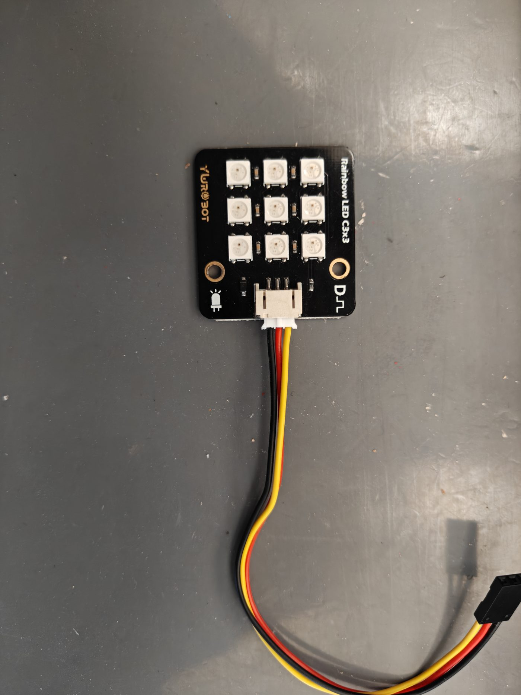

# 第三章　彩灯板（WS2812）

> 目标：让 9 颗灯珠听你的话——开、关、调亮度、换颜色、放 8 种特效，并且**说一句话就能换**。
> 涉及文件：`led_strip_controller.h`（新增）、`config.h`（加 **3 个**宏：GPIO / COUNT / MAX）、`compact_wifi_board.cc`（加 1 行）
>
> **本章是代码解读。** 如果你已按 1.1 把 `代码/` 里的文件拷进工程，下面这些改动**已经在了**——照着读原理就行。想自己从零加一遍，再按文中步骤改。

---

## 3.1 先搞懂 WS2812 是什么



*本项目用的灯板：3×3 共 9 颗 WS2812B，只有一根数据线进（DIN），可以从 DOUT 继续接下一块。*

WS2812 是"**灯珠里自带芯片**"的 RGB LED。每个灯珠有 4 个脚：VCC、GND、DIN（进）、DOUT（出）。

数据是一串串接的：

```
ESP32 ──DIN→ [灯珠1] ──DOUT→ DIN→ [灯珠2] ──DOUT→ DIN→ [灯珠3] ...
```

**一个 GPIO 就能控几百颗**，代价是时序很苛刻。

先建立直觉，不然下面那串微秒数字会没有落点：WS2812 **没有时钟线**，它只靠一根数据线，用"高电平持续多久"来区分 0 和 1——高 0.4μs 判成 0，高 0.8μs 判成 1。两者只差 0.4μs，所以时间误差必须压到 **0.1μs（100 纳秒）**这个量级，否则灯珠就会把 1 听成 0，颜色整片错乱。

| 参数 | WS2812B 要求 |
|---|---|
| 数据速率 | 800kHz（每 bit 1.25μs） |
| "0" 码 | 高电平 0.4μs + 低电平 0.85μs |
| "1" 码 | 高电平 0.8μs + 低电平 0.45μs |
| 每颗灯 | 24 bit（G 8 + R 8 + B 8） |
| 复位 | 低电平持续 > 50μs |

**为什么不能用普通 GPIO 翻转来写**：一旦被 WiFi 中断打断，时序就错了，灯会乱闪。所以必须用**硬件外设**生成精确波形。

---

## 3.2 为什么用 RMT，不用 PWM

ESP32-S3 有两种能生成精确波形的外设：

| 外设 | 能不能做 WS2812 | 说明 |
|---|---|---|
| LEDC（PWM） | ❌ | 只能输出固定频率的方波，做不出 0/1 码的变长脉冲 |
| **RMT** | ✅ | 专门做"红外遥控"的，本质是**可编程脉冲序列发生器**，正好符合 WS2812 需求 |

RMT 的工作方式：把要发送的电平序列（高多久、低多久）塞进内存，硬件自己按顺序打出去，不占 CPU，也不怕中断。

ESP32-S3 有 **4 个 RMT TX 通道**，本项目用 1 个（灯板）。还剩 3 个，意味着**还能接 3 条独立灯带**。

```cpp
led_strip_config_t strip_config = {};
strip_config.strip_gpio_num         = gpio_num_;
strip_config.max_leds               = count_;
strip_config.color_component_format = LED_STRIP_COLOR_COMPONENT_FMT_GRB;  // 注意是 GRB
strip_config.led_model              = LED_MODEL_WS2812;

led_strip_rmt_config_t rmt_config = {};
rmt_config.resolution_hz = 10 * 1000 * 1000;   // 10MHz → 每 tick 0.1μs，够精细
rmt_config.mem_block_symbols = 64;

ESP_ERROR_CHECK(led_strip_new_rmt_device(&strip_config, &rmt_config, &strip_));
```

### 两个容易踩的点

**① 颜色顺序是 GRB，不是 RGB。**
WS2812 内部按 G→R→B 的顺序接收。如果写成 RGB，红色会变成绿色。构造函数留了 `grb_order` 参数，老灯板是 RGB 顺序时传 `false`。

**② `led_strip_clear()` 不会灭灯。**
它只清**内存里的缓冲区**，不改变已经发出去的画面。必须紧跟一次 `led_strip_refresh()`：

```cpp
led_strip_clear(strip_);
led_strip_refresh(strip_);   // ← 少了这一行，灯会一直亮着
```

> 这是本项目踩过的坑之一。当时调了半天以为 `clear` 坏了。

---

## 3.3 整个类的结构

```cpp
class LedStripController {
private:
    // ---- 硬件 ----
    led_strip_handle_t strip_;
    gpio_num_t         gpio_num_;
    int                count_;      // 缓冲区大小（硬件上限）
    std::string        nvs_ns_;     // 每块灯板独立的 NVS 命名空间

    // ---- 状态（语音回调写，渲染任务读）----
    volatile int  active_     = 1;    // 实际亮几颗
    volatile bool power_      = false;
    volatile int  brightness_ = 80;
    volatile int  base_r_ = 255, base_g_ = 255, base_b_ = 255;
    volatile int  effect_     = kSolid;
    volatile int  speed_      = 5;    // 1~10
    volatile int  color_mode_ = kColorRainbow;

    bool lit_ = false;    // 上一帧是否亮着（关灯时只清一次，省带宽）

    // ---- 内部方法 ----
    void Render();        // 算出一帧，刷新
    void TaskLoop();      // 30fps 循环
    void Put(...);        // 写一颗灯珠
    static int  Clamp(int v, int lo, int hi);   // 夹到 [lo, hi]，后面到处在用
    int  StepMs(int base_ms) const;             // 速度档 1~10 → 每格多少毫秒
    static void HsvToRgb(...);
    void MakeRandomColor();                     // random 色：随机一个鲜艳的 HSV
    bool ParseColor(...);
    void SetEffectByName(...);
    static const char* EffectName(int effect);  // 效果编号 → 英文名（get_status 用）

public:
    LedStripController(...);   // 构造函数：初始化 + 注册工具 + 起任务
};
```

> `RainbowAt` 不在这张表里——它是 `Render()` 内部定义的 lambda（见 3.7），不是成员函数。
> 想看完整声明，打开 `代码/led_strip_controller.h`：类从第 41 行开始，`Render()` 在第 255 行。

**设计要点**：所有"状态"都是 `volatile` 的简单变量，没有锁、没有队列。因为只有一个写者（工具回调）和一个读者（渲染任务），`volatile` 足以保证可见性，不需要互斥锁增加复杂度。

---

## 3.4 构造函数逐段讲

```cpp
LedStripController(gpio_num_t gpio_num,
                   int max_leds,
                   const std::string& name  = "light",
                   const std::string& label = "彩灯板",
                   int  active              = 0,
                   bool grb_order           = true)
    : gpio_num_(gpio_num), count_(max_leds), label_(label), nvs_ns_("led_" + name) {
```

| 参数 | 含义 | 举例 |
|---|---|---|
| `gpio_num` | 数据线引脚 | `GPIO_NUM_21` |
| `max_leds` | 缓冲区上限 | 64（固件最多驱动 64 颗） |
| `name` | 工具名前缀 | `"light"` → `self.light.power` |
| `label` | 语音里的称呼 | `"彩灯板"` |
| `active` | 实际亮几颗 | 9（这块板是 3×3） |
| `grb_order` | 颜色顺序 | WS2812 用 `true` |

### 为什么要留一个 NVS 命名空间

```cpp
nvs_ns_ = "led_" + name;
if (nvs_ns_.size() > 15) nvs_ns_.resize(15);   // NVS 命名空间上限 15 字符
```

NVS 是 ESP32 的"小硬盘"，断电不丢。**早期**这里存的是"实际亮几颗"，好处是换一块灯板不用重新烧固件。

**但这条路后来被改掉了**：专门用来写数量的 `set_led_count` 工具已经删除，代码注释写得很直白——"灯珠数量改成在 config.h 里设，不再占工具名额"。所以现在的分工是：

| 动作 | 现在从哪来 |
|---|---|
| **写** | 只有 `config.h` 的 `LED_STRIP_COUNT`（见 3.11） |
| **读** | 构造函数仍会读 `nvs_ns_` 里的 `count` 键，读到就覆盖 |
| **正常情况下** | 没人写 → 读不到 → 用 `config.h` 的值 |

**那这段代码为什么留着**：一是兼容旧固件（当年设过数量的板子，升级后行为不变）；二是命名空间按 `name` 分开，两块灯板互不影响。

> ⚠️ 副作用要记住：如果你**以前**用旧固件设过灯珠数量，那个值还躺在 NVS 里，会盖掉 `config.h` 的新值。表现是"改了宏却不生效"。清一次 flash 就好：`idf.py -p COM15 erase-flash`，然后重新烧。

### 为什么上电不亮

```cpp
volatile bool power_ = false;   // 上电不亮，等用户喊"开灯"
```

听起来反直觉，但是刻意的：如果上电就亮，你半夜插电会被闪一下，而且不知道是"灯在工作"还是"程序跑飞了"。

---

## 3.5 渲染核心：一帧是怎么画出来的

```cpp
void Render() {
    if (strip_ == nullptr) return;

    // 关灯：只清一次就返回
    if (!power_ || brightness_ <= 0) {
        if (lit_) {
            led_strip_clear(strip_);
            led_strip_refresh(strip_);
            lit_ = false;
        }
        return;
    }
    lit_ = true;

    // ★ 关键：先做快照
    const int     n  = active_;
    const int64_t ms = esp_timer_get_time() / 1000;
    const int     r  = base_r_, g = base_g_, b = base_b_;
    const bool    rainbow = (color_mode_ == kColorRainbow);

    switch (effect_) {
        case kSolid: { ... }
        // ...
    }

    led_strip_refresh(strip_);   // 一帧全部画完，才刷新出去
}
```

### 三个细节，缺一不可

**① 快照（`const int n = active_;` 这几行）**

为什么不能直接读成员变量？因为语音回调随时可能改 `active_`。如果循环画到第 5 颗时 `active_` 从 9 变成 16，这一帧就会画得前后不一致，出现"半边灯"的撕裂。

**快的做法**：开头一次性拷到局部变量，整帧都用局部变量。

**② 时间用 `esp_timer_get_time()`，不用帧计数器**

```cpp
const int64_t ms = esp_timer_get_time() / 1000;
```

如果用一个 `int frame_++` 累加，每次加 33ms，`int` 最大值 21 亿毫秒 ≈ **24.8 天**。超过就溢出变成负数，特效会瞬间错乱。

本项目早期就是帧计数器，跑了一个多月后发现"流水灯倒着跑"。改成读取系统微秒时间，永远不会溢出。

**③ 关灯只清一次（`lit_` 标志）**

如果每帧都 `clear + refresh`，即使灯已经灭了也会持续占 RMT 带宽。加一个 `lit_` 标志，只在"从亮变灭"那一帧清一次。

---

## 3.6 8 种特效的算法

全部在一个 `switch (effect_)` 里，每种 5~10 行。

| 特效 | 中文 | 算法一句话 |
|---|---|---|
| `kSolid` | 常亮 | 每颗都写基础色 |
| `kBlink` | 闪烁 | 按周期取模，前半亮后半灭 |
| `kBreath` | 呼吸 | 三角波算亮度，0→100→0 |
| `kFlow` | 流水灯 | 一颗头灯 + 3 颗渐暗尾巴，位置随时间前移 |
| `kMarquee` | 跑马灯 | 每 3 颗亮 1 颗，整体位移绕圈 |
| `kRainbow` | 彩虹 | 每颗按位置取色相，色相随时间旋转 |
| `kMeteor` | 流星 | 一颗头灯 + 5 颗长尾，跑出边界后重置 |
| `kStrobe` | 爆闪 | 白色，40ms 极短脉冲 |

### 举三个例子

**流水灯**（最直观）：

```cpp
case kFlow: {
    int head = static_cast<int>((ms / StepMs(300)) % n);
    for (int i = 0; i < n; i++) Put(i, 0, 0, 0);      // 先全灭
    for (int k = 0; k <= 3; k++) {                     // 头灯 + 3 颗尾巴
        int idx = ((head - k) % n + n) % n;            // 负数取模要 +n 再 %
        int rr = r, gg = g, bb = b;
        if (rainbow) RainbowAt(idx, rr, gg, bb);
        Put(idx, rr, gg, bb, 100 - k * 30);            // 尾巴亮度递减 100/70/40/10
    }
    break;
}
```

**注意 `((head - k) % n + n) % n`**：C++ 里 `-1 % 9` 是 `-1` 不是 `8`。头灯走到 0 号位时，尾巴会跑到负数索引。加 `n` 再取模才是环形。

**呼吸灯**：

```cpp
case kBreath: {
    int period = Clamp(4000 - speed_ * 320, 700, 4000);   // 速度越快周期越短
    int phase  = static_cast<int>(ms % period) * 2;       // 0 ~ 2*period
    int level  = (phase <= period)
                     ? phase * 100 / period              // 上升
                     : (2 * period - phase) * 100 / period;  // 下降
    for (int i = 0; i < n; i++) Put(i, r, g, b, level);
    break;
}
```

**爆闪**：

```cpp
case kStrobe: {
    int period = Clamp(700 - speed_ * 55, 120, 700);
    bool on = (ms % period) < 40;    // 40ms 极短亮，其余时间灭
    for (int i = 0; i < n; i++) Put(i, on ? 255 : 0, on ? 255 : 0, on ? 255 : 0);
    break;
}
```

### 速度是怎么统一的

所有特效都用 `speed_`（1~10），但换算方式不同：

```cpp
int StepMs(int base_ms) const {     // 用于"走格子"类特效
    int s = clamp(speed_, 1, 10);
    int ms = base_ms / s;
    return ms < 20 ? 20 : ms;       // 最小 20ms，再快人眼也看不出
}
```

`speed_ = 1` 时每格 300ms，`speed_ = 10` 时 30ms。

> **剩下 5 种没贴**（blink / marquee / rainbow / meteor / solid），不是省略，是套路完全一样：先算位置或相位，再逐颗 `Put()`。
> 完整 8 个 `case` 在 `代码/led_strip_controller.h` 的 `Render()` 里（第 255 行起），对着上面那张表一行行看，10 分钟能读完。

---

## 3.7 彩虹：为什么它看起来"高级"

原生 WS2812 只能用 RGB 表示颜色，直接随机三通道会得到一堆灰暗的杂色。**用 HSV 才是对的**：

- H（色相）0~360 是颜色环
- S（饱和度）控制鲜艳程度
- V（明度）控制亮不亮

想要"鲜艳的颜色"，固定 `S=255, V=255`，只改 H。

```cpp
static void HsvToRgb(int h, int s, int v, int& r, int& g, int& b) {
    h = ((h % 360) + 360) % 360;
    int i = h / 60;          // 落在哪个 60° 扇区
    int f = h % 60;          // 扇区内偏移
    int p = v * (255 - s) / 255;
    int q = v * (255 - s * f / 60) / 255;
    int t = v * (255 - s * (60 - f) / 60) / 255;
    switch (i) {
        case 0:  r = v; g = t; b = p; break;
        ...
    }
}
```

六个 `case` 只是 `r/g/b` 三个分量的不同排列，记住 `case 0` 就够了。完整代码在 `代码/led_strip_controller.h` 第 100 行的 `HsvToRgb()`。

### 彩虹流动（每颗灯珠不同色）

```cpp
auto RainbowAt = [&](int index, int& rr, int& gg, int& bb) {
    int hue = index * 360 / n + static_cast<int>(ms / 16) % 360;
    HsvToRgb(hue, 255, 255, rr, gg, bb);
};
```

- `index * 360 / n`：9 颗灯把 360° 色环均分，每颗差 40°
- `ms / 16 % 360`：随时间旋转，约 5.8 秒转一圈

**这就是"流水灯变彩色"的实现**。之前流水灯是白色的，就是因为没有这个函数，所有灯珠用同一个 `(255,255,255)`。

### 随机色也要"鲜艳"

```cpp
void MakeRandomColor() {
    int hue = esp_random() % 360;
    int sat = 210 + esp_random() % 46;   // 82%~100%，不会太灰
    int val = 210 + esp_random() % 46;   // 82%~100%，不会太暗
    ...
}
```

如果用 `rand() % 256` 直接生成 RGB，平均亮度只有 128，看起来又灰又土。

---

## 3.8 亮度是怎么叠加的

```cpp
void Put(int index, int r, int g, int b, int scale = 100) {
    if (strip_ == nullptr || index < 0 || index >= active_) return;
    int k = brightness_ * scale / 100;   // scale 是"帧内额外衰减"
    if (k <= 0) {
        led_strip_set_pixel(strip_, index, 0, 0, 0);
        return;
    }
    led_strip_set_pixel(strip_, index,
                        (uint32_t)r * k / 100,
                        (uint32_t)g * k / 100,
                        (uint32_t)b * k / 100);
}
```

两层缩放：

- `brightness_`：全局亮度，语音调的就是它
- `scale`：帧内衰减，用来做拖尾（头灯 100%、尾巴 70%、40%、10%）

两者相乘得到最终亮度，所以"低亮度下的拖尾"依然正确。

---

## 3.9 5 个工具

| 工具名 | 参数 | 说明 |
|---|---|---|
| `self.light.power` | `on` (bool) | 开关 |
| `self.light.set_brightness` | `brightness` (0~100) | 亮度，大于 0 会自动开灯 |
| `self.light.set_color` | `color` (string) | 20 种颜色名 / `#RRGGBB` / `random` |
| `self.light.set_effect` | `effect` / `speed` / `color` | 8 种特效 |
| `self.light.get_status` | — | 返回 JSON 状态 |

### 为什么颜色用一个字符串参数

原来是 `set_color(r, g, b)` 三个整数，模型经常传错（比如把 255 传成 1）。

改成传颜色名后：

```cpp
PropertyList({ Property("color", kPropertyTypeString, std::string("red")) })
```

描述里把 20 种颜色名全列出来，模型直接选词，几乎不会错。`ParseColor()` 里还要兼容中文名、`#RRGGBB`、`random`——因为用户可能说"来个骚一点的"，模型会传 `random`。

### 为什么 `set_effect` 要带 color 参数

```cpp
Property("color", kPropertyTypeString, std::string("auto"))   // auto / rainbow / single
```

因为流水灯、跑马灯、流星这三个特效本身不带颜色，需要告诉它"用彩虹还是单色"。

`auto` 的判断逻辑很实用：

```cpp
color_mode_ = (base_r_ == 255 && base_g_ == 255 && base_b_ == 255)
                  ? kColorRainbow     // 还是纯白 = 用户没挑过颜色 → 给彩虹
                  : kColorSingle;     // 用户挑过 → 跟随那个颜色
```

---

## 3.10 怎么用（对着小智说）

| 你说 | 发生什么 |
|---|---|
| "打开彩灯" | `power(true)` |
| "把灯调暗一点" | 先 `get_status()` 查当前亮度，再 `set_brightness(当前值 − 20)` |
| "换成红色" | `set_color("red")` |
| "随机换个颜色" | `set_color("random")` |
| "来个流水灯" | `set_effect("flow", 5, "auto")` → 彩色流水 |
| "红色跑马灯，快一点" | 先 `set_color("red")`，再 `set_effect("marquee", 8, "single")` |
| "彩灯现在什么状态" | `get_status()` |

**演示效果最好的一句**："彩虹流水灯，速度 8"。

> **亮度是绝对值（0~100），不是"加减多少"**。所以模型听到"调暗一点"会做两步：先 `get_status` 拿到当前亮度（比如 80），再传一个更小的数。演示时看到它连着调两次工具，不是它犯傻，就是这两步。
> 如果你直接说"亮度 50"，它就只调一次。这也解释了工具描述里为什么要写"先调 get_status"。

---

## 3.11 换一块不同数量的灯板

改 `config.h` 一行就够了：

```cpp
#define LED_STRIP_COUNT 9     // 改成新灯板的灯珠数，比如 16 / 24 / 64
```

`LED_STRIP_MAX` 是缓冲区上限（64），只要新灯板不超过它就不用动。

**不用改代码**，因为：
- 实际数量从宏传进构造函数
- 所有特效都是按 `n = active_` 计算的，不写死 9

如果新灯板超过 64 颗，把 `LED_STRIP_MAX` 一起改大（RAM 占用 = 灯珠数 × 3 字节 + RMT 缓冲，不大）。

---

## 3.12 这一章的坑（都踩过）

| 现象 | 原因 | 解决 |
|---|---|---|
| 流水灯、跑马灯全是**白色** | 默认基础色 `(255,255,255)`，特效只算位置不算颜色 | 加 `RainbowAt` + `color` 参数 |
| 调 `clear()` 灯不灭 | 只清了缓存 | 补 `refresh()` |
| 跑了一个多月特效错乱 | `int` 帧计数溢出 | 改 `esp_timer_get_time()` |
| 改了 `LED_STRIP_COUNT` 却不生效 | NVS 里还留着旧固件写进去的数量，会盖掉宏 | `idf.py -p COM15 erase-flash` 后重烧 |
| 红色显示成绿色 | 颜色顺序用了 RGB | 改 `LED_STRIP_COLOR_COMPONENT_FMT_GRB` |
| 灯板闪、主板重启 | 从 3V3 取电 | 独立 5V + 共地 |

> 这张表只收灯板自己的问题。供电、屏幕、工具超限这类跨章问题在 [06 章](06-踩坑与排查.md)，不用在这儿重复找。

---

下一章：[04-直流电机与差速控制.md](04-直流电机与差速控制.md)
