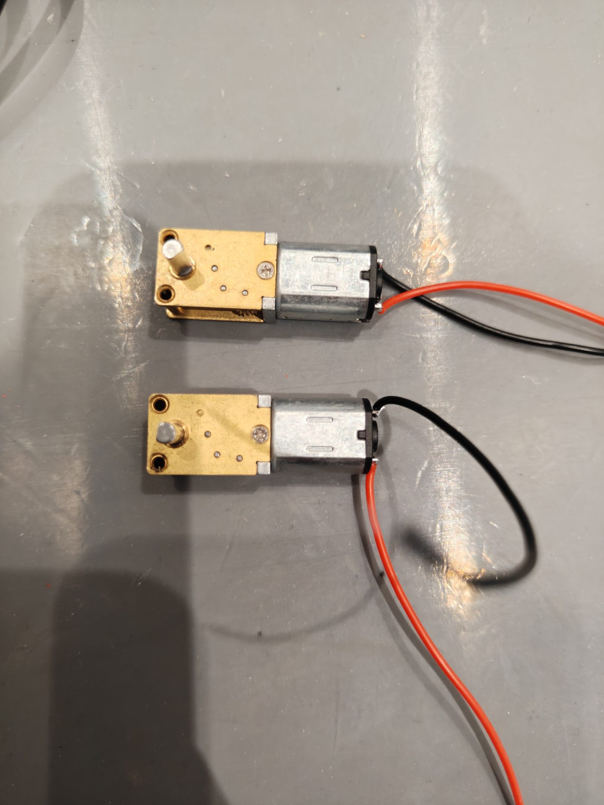
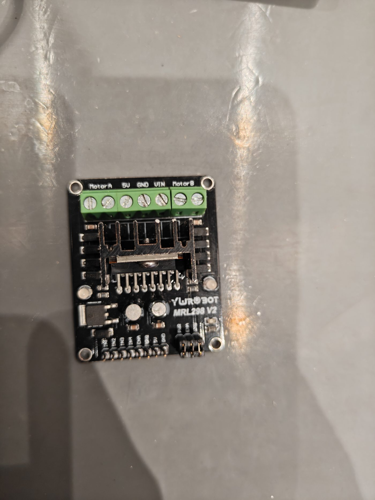
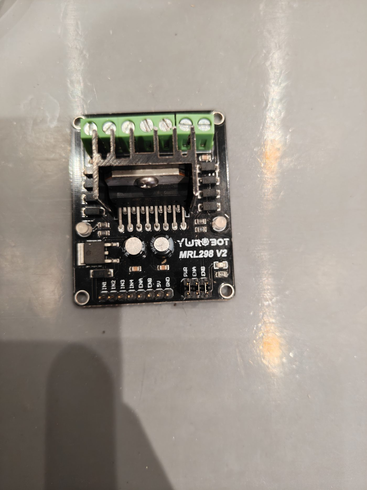
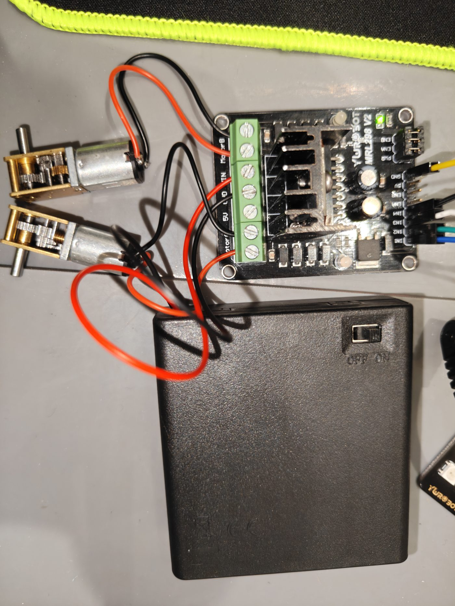
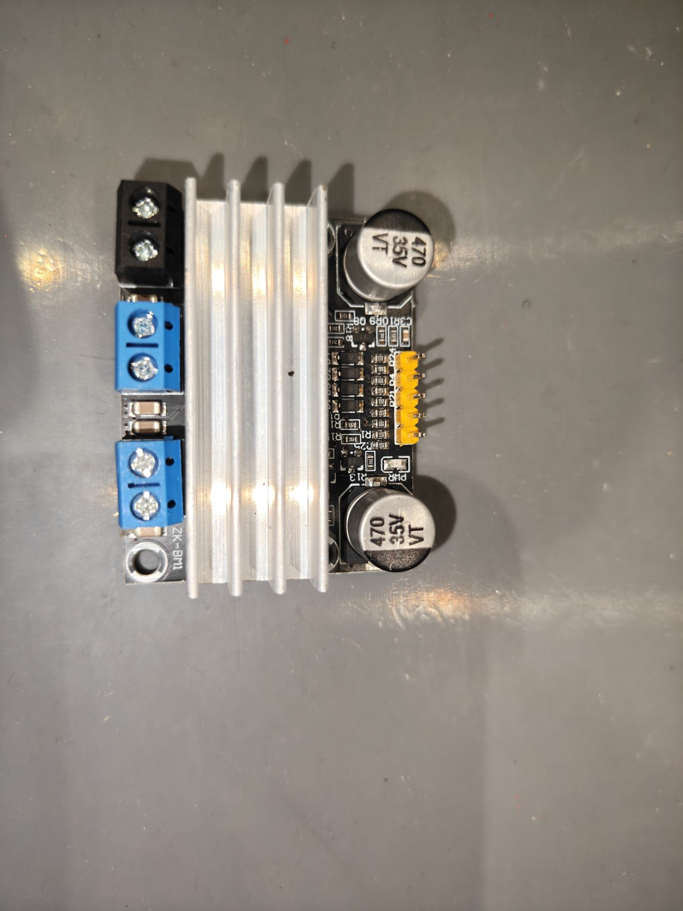
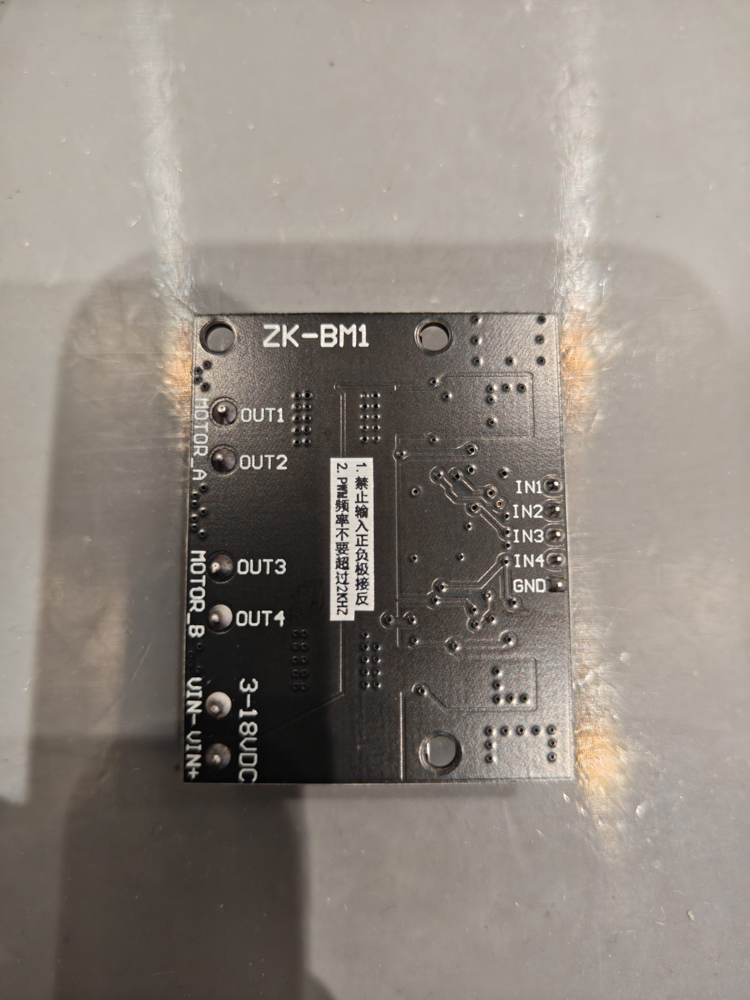

# 第四章　直流电机与差速控制

> 目标：两个电机能正转、反转、调速，说“两个电机正转”就一起转，说“向右转”就一边快一边慢。
> 涉及文件：`dc_motor_controller.h`（新增）、`config.h`（6 个宏）、`compact_wifi_board.cc`（3 行实例化）
>
> **本章是代码解读。** 如果你已按 1.1 把 `代码/` 里的文件拷进工程，下面这些改动**已经在了**——照着读原理就行。想自己从零加一遍，再按文中步骤改。

---

## 4.1 为什么电机不能直接接 GPIO



*N20 减速电机，尾部两根线没有正负之分（反了就是反转），前面自带减速箱和轮轴。*

ESP32 的 GPIO 最大输出约 **40mA**，而 N20 电机堵转时要 **几百 mA**。直接接会烧掉 IO。

而且电机是**感性负载**，断电瞬间会产生反向高压（反电动势），能把 GPIO 打死。

所以必须中间加一层"开关"——**H 桥**。

### H 桥是什么

四个开关排成 H 形，电机就是中间那条横杠：

```
        VCC
    ┌────┬────┐
   S1    │    S3
    │  电机  │
   S2    │    S4
    └────┴────┘
        GND
```

**不用背编号，只记两句话**：

- **左上 + 右下**同时导通 → 电流从左往右穿过电机 → **正转**
- **右上 + 左下**同时导通 → 电流从右往左 → **反转**

也就是**对角线上的两个开关成对打开**。

| 同时导通 | 电流方向 | 结果 |
|---|---|---|
| 左上 + 右下 | 左 → 右 | 正转 |
| 右上 + 左下 | 右 → 左 | 反转 |
| 都不导通 | — | 停止 |

ZK-BM1、MRL298 这类双路模块，就是把两套 H 桥和驱动电路集成到一块板上，一块能控两个电机。

**绝对不能做的**：同一侧上下两个开关（左上 + 左下）同时导通，等于把电源直接短路，模块立刻烧。所以代码里 `Pct()` 永远保证"一侧有占空比，另一侧强制为 0"。

---

## 4.2 两种常见驱动板，接线完全不同

市面上最常用的两块双路驱动板，引脚定义差别很大，**买之前要看清是哪种**。

本项目用的是 **MRL298 V2**（带 ENA/ENB 排针），另一块 **ZK-BM1** 是常见替代品。两块都拍了实物照片——**先对照照片认出手上这块，再照它的表接线**。接错一般不会烧，但电机一定不转，排查起来很费时间。

### 本项目用的：MRL298 V2



绿色端子标着 `MotorA / 5V / GND / VIN / MotorB`（**位数因批次不同**，见下方实拍那块是 6 位）。



控制端排针：`IN1 IN2 IN3 IN4 ENB …5V GND`，另有一组 `PWM / ENA` 跳线。

| MRL298 V2 | 接 |
|---|---|
| VIN / GND | 电机电源 |
| IN1 / IN2 | GPIO1 / GPIO2（1 号电机） |
| IN3 / IN4 | GPIO38 / GPIO18（2 号电机） |
| **ENA / ENB** | **保留跳线帽**（本项目走 IN-IN，靠跳线帽把使能拉高） |
| OUT1 / OUT2 | 1 号电机两根线 |
| OUT3 / OUT4 | 2 号电机两根线 |



实拍图里能看清接线的分工：

- **左侧绿色端子**接两个 N20 电机的两根线（橙 / 黑），这是电机输出
- **右侧黄色排针**引出的黄、黑、白、蓝四根跳线去 ESP32，对应 `IN1 / IN2 / IN3 / IN4`
- **带开关的 4 节干电池盒**经红黑线进驱动板电源端子（电机单独一路，不与主板共用）

> ⚠️ 绿色端子的位数**因批次不同**（本项目这块是 **6 位**，另有 5 位版本）。**接线永远以板上丝印为准**，不要照抄网上的图。

### 备选：ZK-BM1



蓝色端子是电机输出，黄色排针只有 **IN1~IN4 + GND**。



背面的丝印把接口标得很清楚：

```
MOTOR_A : OUT1 / OUT2
MOTOR_B : OUT3 / OUT4
VIN- / VIN+  (3-18 VDC)
IN1  IN2  IN3  IN4  GND
```

**关键：它没有 ENA/ENB**，所以只能走 IN-IN 模式——四个 IN 脚直接接 PWM。本项目代码本来就走这个模式，换上这块板不用改代码。

| ZK-BM1 | 接 |
|---|---|
| VIN+ / VIN− | 电机电源（本项目 4 节干电池，约 6V） |
| GND（控制端） | **与 ESP32 共地** |
| IN1 / IN2 | GPIO1 / GPIO2（1 号电机） |
| IN3 / IN4 | GPIO38 / GPIO18（2 号电机） |
| OUT1 / OUT2 | 1 号电机两根线 |
| OUT3 / OUT4 | 2 号电机两根线 |

⚠️ 板上两条丝印警告，都要当真：

1. **禁止输入正负极接反** —— 这块板没有防反接保护，反接直接烧
2. **PWM 频率不要超过 20kHz** —— 本项目用 10kHz，安全

### ⚠️ 那块要命的跳线帽

MRL298 / L298N 上 ENA、ENB 各有一个跳线帽，短接了 5V 和使能脚。**拔掉后两路输出全部关闭，电机一动不动。**

这是本项目实际踩过的坑：改了代码、换了引脚、查了半天，最后发现是跳线帽被拔了。

**判断方法**：走 IN-IN 模式时，跳线帽必须**保留**。

### 快速分辨你手上是哪块

| 特征 | ZK-BM1 | MRL298 V2 |
|---|---|---|
| 控制排针 | 4 个 IN + GND | 4 个 IN + ENA/ENB + 5V + GND |
| 有没有 ENA/ENB | ❌ 没有 | ✅ 有 |
| 散热片 | 有，很大一块 | 无（芯片裸露） |
| 电机端子 | 蓝色 4 位 | 绿色 **5~6 位都有**（看批次，以丝印为准） |
| 能用的模式 | 只能 IN-IN | IN-IN 或 EN-IN 都行 |

---

## 4.3 两种驱动模式

驱动板有两种常见接法，代码都支持：

### IN-IN 模式（本项目用的）

只有两根线进驱动板，PWM 直接打在 IN 脚上：

```
IN1 = PWM  →  正转，占空比 = 速度
IN2 = 0
```

反转就交换。**优点**：省引脚（每个电机 2 脚）。**缺点**：某些驱动板对 IN 脚的 PWM 频率有限制。

### EN-IN 模式

三根线：EN 接 PWM，IN1/IN2 只做电平（方向）：

```
EN  = PWM  →  速度
IN1 = 1, IN2 = 0  →  正转
IN1 = 0, IN2 = 1  →  反转
```

**优点**：方向由电平决定，更稳。**缺点**：每个电机 3 脚。

代码里用 `enum Mode { kInIn, kEnIn }` 区分，两个构造函数重载：

```cpp
DcMotor(gpio_num_t in1, gpio_num_t in2, name, label, invert);        // IN-IN
DcMotor(gpio_num_t en, gpio_num_t in1, gpio_num_t in2, name, label, invert);  // EN-IN
```

---

## 4.4 LEDC：怎么产生 PWM

ESP32-S3 的 LEDC 有 **8 个通道**，分成 4 组定时器。本项目配置：

```cpp
static constexpr int kFreqHz   = 10000;   // 10kHz
static constexpr int kDutyBits = 12;      // 12 位 = 4096 级
static constexpr int kDutyMax  = 4095;
```

**为什么是 10kHz**：太低（如 1kHz）电机会发出刺耳的啸叫；太高（如 20kHz）部分驱动板跟不上，输出会失真，ZK-BM1 的丝印明确写了"PWM 频率不要超过 20kHz"。10kHz 在"耳朵听不见"和"驱动板跟得上"之间。

**为什么是 12 位**：4096 级调速足够细。位数越高频率上限越低（两者共用一个定时器），12 位 + 10kHz 是可行的组合。

### 通道分配：一个容易忽略的细节

```cpp
// 通道从 7 往下分：7、6、5、4。舵机从 0 往上，两边留出余量。
static ledc_channel_t AllocChannel() {
    static int next = LEDC_CHANNEL_MAX - 1;
    if (next < 4) {
        ESP_LOGE("Motor", "LEDC 通道用尽（舵机太多），电机可能无法输出");
        return LEDC_CHANNEL_4;
    }
    return static_cast<ledc_channel_t>(next--);
}
```

- 电机：**从 7 往下**分配（7→6→5→4）
- 通道 **0~3 现在完全空着**：舵机改走 I2C（PCA9685）以后，LEDC 已经不用再分给舵机了

代码里那句注释"舵机从 0 往上，两边留出余量"是**旧方案**留下来的（当年舵机用 LEDC 直驱），现在没有舵机占 LEDC 了。

**能不能用这 4 个空通道再挂 2 个电机？能，但要改一个数字**：`AllocChannel()` 里写死了 `if (next < 4)`，意思是"发到 4 号就停"，所以默认不会再往下发。想用 0~3，把它改成 `if (next < 0)`。改之前先算工具数（见 7.2）。

这个"从高位往下分"的设计在"以后要加电机"的场景下很有用：电机通道固定在高位，谁占了几号一眼看得出来。如果都从 0 往上，加到第 5 个就撞车了。

---

## 4.5 28% 起步补偿：为什么速度 10% 电机不动

这是本项目最实用的一个细节。

直流电机的转速和占空比不是线性的。**低于某个阈值，电机根本转不起来**，只会发出"嗡嗡"声并发热。N20 的这个阈值实测在 **25%~30%** 左右。

如果直接把 `速度 10%` 映射成 `占空比 10%`，用户说"慢一点"就会得到一台不动的机器，然后以为坏了。

### 解决办法：把 1~100 重新映射到 28~100

```cpp
static constexpr int kMinDrivePct = 28;     // 起步占空比

static int PctToDuty(int pct) {
    if (pct <= 0)   return 0;
    if (pct >= 100) return kDutyMax;
    int real = kMinDrivePct + (100 - kMinDrivePct) * pct / 100;   // 28 ~ 100
    return real * kDutyMax / 100;
}
```

效果：

| 输入 | 实际占空比 | 现象 |
|---|---|---|
| `level 1`（Pct 10） | 35% | 能转，很慢 |
| `level 5`（Pct 50） | 64% | 中速 |
| `level 10`（Pct 100） | 100% | 全速 |
| 停（Pct 0） | 0 | 停 |

注意最低一档（`level 1`）不是 10%，而是 **35%**；就算直接传 `Pct 1`，也会被抬到 28% 的启动阈值。这正是"补偿"的含义：用户能选到的最低速度，一定在电机的启动阈值之上，不会出现"选了 1 档却一动不动"。

### 三套刻度对照（全章最容易绕晕的地方）

"速度"这个事，代码里同时存在三种写法，它们是一条换算链，不是三个独立概念：

```
语音/模型层         代码层                硬件层
level 1~10   →   Pct -100~100   →   duty 0~4095
```

| 层 | 范围 | 谁在用 | 例子 |
|---|---|---|---|
| `level` | 0~10 | 工具参数（`run` / `move`） | 用户说"中速" → 5 |
| `Pct` | -100~100 | `DcMotor::Pct()`，负数 = 反转 | 5 档 → 50，反转 → -50 |
| `duty` | 0~4095 | `ledc_set_duty()` 的最终值 | 50% → 补到 64% → 2620 |

跟着走一遍（`level=5` 前进）：

1. `level 5` → `BasePct()` 算成 `5 × 10 = 50`（%）
2. 50% 过起步补偿 → `28 + 72 × 50 / 100 = 64`（%）
3. 64% → `64 × 4095 / 100 = 2620`（duty，整数除法）

反过来也有用：串口里看到 `duty=2620`，就能倒推出"这是在用 5 档前进"。

**副作用**：低速档的"分辨率"变低了（1~10 档里前几档差别不大）。对演示来说可以接受，对需要精细调速的场合要换更好的电机或加编码器。

---

## 4.6 完整驱动代码

```cpp
// 直接给百分比（-100~100），CarController 用它做差速
void Pct(int percent) {
    if (!ready_) return;
    if (percent > 100)  percent = 100;
    if (percent < -100) percent = -100;
    pct_ = percent;
    dir_ = percent > 0 ? 1 : (percent < 0 ? -1 : 0);

    int out = invert_ ? -percent : percent;    // ← 方向取反在这一行

    if (mode_ == kEnIn) {
        // 三线模式：IN 定方向，EN 给 PWM
        if (out > 0)      { gpio_set_level(in1_, 1); gpio_set_level(in2_, 0); }
        else if (out < 0) { gpio_set_level(in1_, 0); gpio_set_level(in2_, 1); }
        else              { gpio_set_level(in1_, 0); gpio_set_level(in2_, 0); }
        WriteDuty(ch1_, out < 0 ? -out : out);
        return;
    }

    // 两线模式：一个脚给 PWM，另一个强制 0（防止 H 桥直通）
    if (out > 0)      { WriteDuty(ch1_, out);  WriteDuty(ch2_, 0); }
    else if (out < 0) { WriteDuty(ch1_, 0);    WriteDuty(ch2_, -out); }
    else              { WriteDuty(ch1_, 0);    WriteDuty(ch2_, 0); }
}
```

### 先补一个上面用到、但没定义的函数

`WriteDuty(ch, pct)` 是这两行的封装，作用就一句：**把百分比换成 duty，写进去，并让它立刻生效**。

```cpp
static void WriteDuty(ledc_channel_t ch, int pct) {
    ledc_set_duty(LEDC_LOW_SPEED_MODE, ch, PctToDuty(pct));   // 算出 0~4095
    ledc_update_duty(LEDC_LOW_SPEED_MODE, ch);                // 少了这行，新值不会生效
}
```

`ledc_set_duty` 只改寄存器里的比较值，`ledc_update_duty` 才让它在这个周期生效——和灯板那个 `led_strip_clear` / `refresh` 是同一类"改了不等于发了"的坑。

### 三个要点

**① `invert_` 为什么存在**

两个电机是**镜像安装**的（一个在左、一个在右，输出轴朝向相反）。同一个信号送到左电机是“向前”，送到右电机就是“向后”。

如果两侧都不反相，说"前进"会变成原地打转。

```cpp
#define MOTOR1_INVERT 0     // 左轮
#define MOTOR2_INVERT 1     // 右轮，反相
```

**改方向不用拆线，改这个宏即可。**

**② 为什么"另一侧强制 0"**

H 桥直通会烧模块。`out > 0` 时，ch1 有占空比、ch2 必须为 0，这是硬约束，不能省。

**③ `ready_` 检查**

如果引脚配置失败（比如通道用尽），`ready_ = false`，所有操作直接返回，不会写非法引脚导致崩溃。

---

## 4.7 差速转向：为什么两侧反向就是转向

差速转向的原理很简单：**两侧转速不同 → 整体转向**。

```cpp
void Apply() {
    const int base  = BasePct();          // speed_ * 10，比如 5 档 = 50%
    int inner = base * 30 / 100;          // 内侧轮 = 外侧的 30%
    if (inner < 1) inner = 1;

    switch (action_) {
        case kForward:   left_.Pct(base);   right_.Pct(base);  break;
        case kBackward:  left_.Pct(-base);  right_.Pct(-base); break;
        case kTurnLeft:  left_.Pct(inner);  right_.Pct(base);  break;   // 左轮慢 → 左拐
        case kTurnRight: left_.Pct(base);   right_.Pct(inner); break;
        case kSpinLeft:  left_.Pct(-base);  right_.Pct(base);  break;   // 原地转
        case kSpinRight: left_.Pct(base);   right_.Pct(-base); break;
        default:         left_.Stop(); right_.Stop(); break;
    }
}
```

| 动作 | 左轮 | 右轮 | 结果 |
|---|---|---|---|
| `kForward` | +50 | +50 | 直行 |
| `kTurnLeft` | +15 | +50 | 左转（半径大） |
| `kSpinLeft` | −50 | +50 | 原地左转 |
| `kBackward` | −50 | −50 | 反转 |

**内侧取 30% 而非 0**：如果内侧完全停住，转弯会很生硬、打滑。留 30% 让它"边走边转"，轨迹更圆滑。

**为什么不给轮子装编码器**：差速转向是**开环**的，转多少度靠"转多久"估算，实际会偏。要精确转 90° 必须加编码器 + PID，成本翻倍。对教学演示够用，对比赛不够。

---

## 4.8 工具：为什么只有 3 + 4 个

### 单个电机（每个 3 个）

| 工具 | 参数 | 说明 |
|---|---|---|
| `self.motor1.run` | `direction` / **`level`** / `seconds` | 正转/反转，1~10 档，跑几秒后自动停 |
| `self.motor1.speed` | `delta` | 在当前档位上增减（"快一点"传 +1） |
| `self.motor1.stop` | — | 立即停 |

### 电机组（4 个）

| 工具 | 参数 | 说明 |
|---|---|---|
| `self.car.move` | `action` / `level` / `seconds` | forward/backward/turn_left/turn_right/spin_left/spin_right |
| `self.car.speed` | `delta` | 档位增减 |
| `self.car.stop` | — | 停 |
| `self.car.get_status` | — | 查当前动作和档位 |

**`seconds` 参数的意义**：语音说“前进两秒”，模型传 `seconds=2`，固件用 `esp_timer` 到点自动停。如果没有这个参数，用户说“前进”之后电机会一直转，直到你说停。

```cpp
void ArmTimeout(int seconds) {
    if (seconds <= 0) return;
    if (timer_ == nullptr) { /* 创建一次性定时器 */ }
    esp_timer_stop(timer_);
    esp_timer_start_once(timer_, (uint64_t)seconds * 1000000ULL);
}
```

### `speed(delta)` 为什么比 `speed(level)` 好用

用户说"快一点"，模型不知道当前是几档。传 `delta=+1` 就不需要知道当前值，逻辑更简单、更不容易错。

代价是：如果模型猜错了 delta（比如传 +3），速度会突变。可以接受。

### 一个例外：电机没就绪，工具根本不注册

05 章会说"初始化失败只打日志，工具照样注册"。**`DcMotor` 是反例**：

```cpp
void RegisterTools() {
    if (name_.empty() || !ready_) return;   // ← 引脚没分配成功，一个工具都不注册
    ...
}
```

**为什么不一样**：舵机总线没通时，工具还能回答"驱动板未就绪"，这句话对排查有用；而电机引脚分配失败后，`run` 无论怎么调都不会动，注册了只会让模型自信地说"已经前进了"，反而更难查。所以这里选择"干脆不出现"。

> 判断标准：初始化失败后，这个工具还能不能给出**有意义的信息**？能 → 注册（调用时返回错误说明）；不能 → 不注册。

---

## 4.9 实测踩过的坑

| 现象 | 原因 | 解决 |
|---|---|---|
| 电机**完全不动** | ① MRL298/L298N 的 ENA/ENB 跳线帽被拔 ② ZK-BM1 的话多半是 IN 脚接错 | 装回跳线帽 / 核对 IN1~IN4 |
| 一个电机不动，另一个正常 | 该路 IN 脚所在的 GPIO 实际不通（杜邦线/排针接触不良） | 换引脚（本项目 2 号电机的 IN2 从某脚换到 GPIO18） |
| 两个电机都转，但整体**原地打转** | 两个电机镜像安装，方向相反 | 一侧 `INVERT=1` |
| 低速档电机"嗡嗡"响但不转 | 占空比低于 28% 的启动阈值 | `PctToDuty` 做起步补偿 |
| 跑到一半自己停 | `seconds` 超时 | 这是正常行为，重新下指令 |
| 电机一转，屏幕花屏/重启 | 电机电源和逻辑电源共用，电流冲击 | 电机电源独立 + 加大电容 |

> 上表是电机专有的坑。供电、烧录、屏幕、工具超限这些**跨章**问题统一在 [06 章](06-踩坑与排查.md)，这里不重复。

### 排查顺序（很重要）

遇到"不动"别急着改代码，按这个顺序查：

1. **听**：有没有"嗡嗡"声？有声音 = 有电但不转（堵转/占空比低）；完全静音 = 没信号或没电。
2. **量**：万用表量驱动板 OUT 两端电压。有电压 = 驱动板在工作，问题在电机或线；没电压 = 驱动板没收到指令。
3. **换**：把电机直接接电池，确认电机本身是好的。
4. **查代码**：看串口日志里 `Motor` 那一行有没有打印成功，`ready_` 是否为真。

---

下一章：[05-舵机与PCA9685.md](05-舵机与PCA9685.md)
