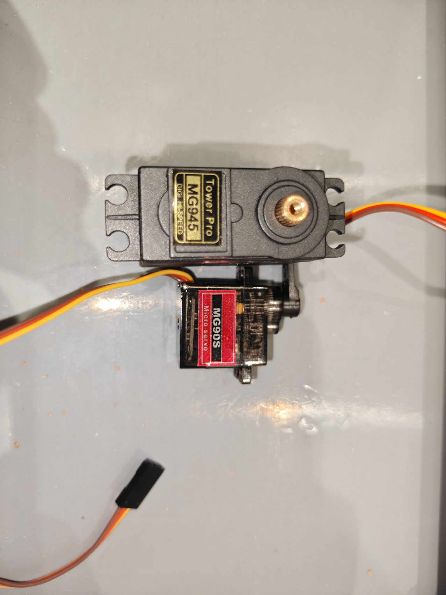
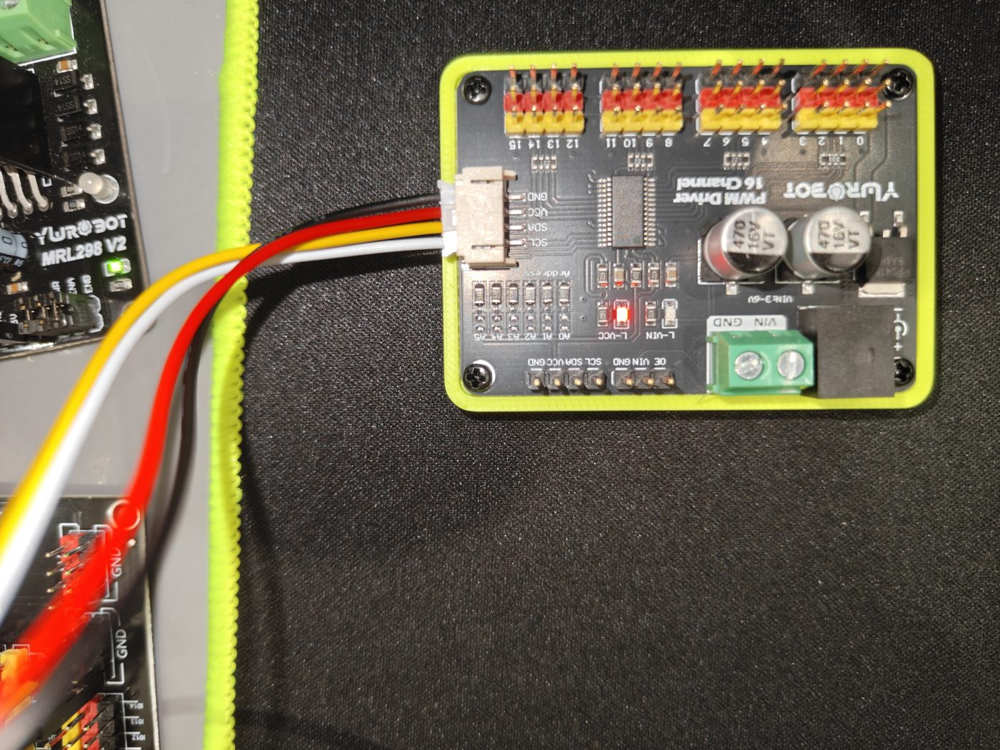
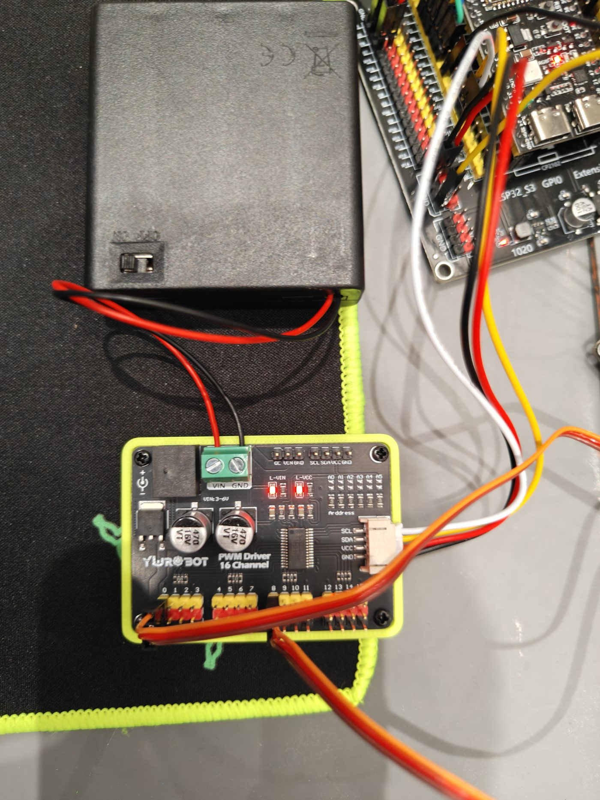

# 第五章　舵机与 PCA9685 扩展板

> 目标：180° 舵机按角度定位、360° 舵机调速正反转，全部挂在一条 I2C 总线上，**只占 4 个工具名额**。
> 本项目实物：**1 个 180°（1 号，通道 0）+ 3 个 360°（9/10/11 号，通道 8/9/10）**；代码预留 11 路，其余空着。
> 涉及文件：`pca9685_servo.h`（新增）、`config.h`（7 个宏）、`compact_wifi_board.cc`（1 张表 + 1 行）
>
> **本章是代码解读。** 如果你已按 1.1 把 `代码/` 里的文件拷进工程，下面这些改动**已经在了**——照着读原理就行。想自己从零加一遍，再按文中步骤改。

---

## 5.1 舵机到底是什么

舵机内部是：**小电机 + 减速齿轮 + 电位器 + 控制电路**。

你给它一个 PWM 信号，它自己闭环转到对应角度——**你不需要知道它转到哪了，它自己知道**。

### 控制信号：50Hz 的 PWM

| 参数 | 值 |
|---|---|
| 周期 | **20ms（50Hz）** |
| 高电平宽度 | 决定角度 |
| 500μs | 0°（或反向满速） |
| 1500μs | 90°（中位） |
| 2500μs | 180°（或正向满速） |

```
      ┌────┐                    ┌────┐
      │    │                    │    │
──────┘    └────────────────────┘    └──────
      ↑ 1.5ms  ← 20ms 周期 →
```

**关键点**：舵机不关心"周期有多准"，只关心"高电平有多宽"。所以 50Hz 是个约定，实际 49~51Hz 都能工作。

### 180° 和 360° 的区别



*上图：大的是 TowerPro **MG945**（本项目用 **3 个**做 360° 连续旋转），小的是 **MG90S**（本项目用 **1 个**做 180° 位置控制）。两者外形差别明显，接线都是三线（棕=GND、红=VCC、橙=信号）。*

| 类型 | 型号 | 同样的 PWM 信号 | 内部 |
|---|---|---|---|
| **180° 位置舵机** | MG90S | 转到对应角度，**停在那里** | 有电位器反馈，闭环 |
| **360° 连续舵机** | MG945 | 1500μs 停、<1500 反转、>1500 正转，**脉宽决定速度** | 电位器被拆掉，改成了全速正/反转 |

**所以两类舵机必须分开处理**：
- 180° 用 `SetAngle(index, 0~180)`
- 360° 用 `SetSpeed(index, -100~100)`

调错了不会烧，但会得到莫名其妙的动作（比如对 360° 舵机设"90 度"，它会停住不动，因为 90° 对应的就是 1500μs）。

---

## 5.2 为什么不能像电机那样直接用 LEDC

先看资源账。这里要算**两遍**，因为「代码预留的」和「实物接的」差得很多：

**第一遍：按代码预留的满配算**

| 需求 | 需要的 PWM 通道 |
|---|---|
| 8 个 180° 舵机 | 8 |
| 3 个 360° 舵机 | 3 |
| 2 个电机（IN-IN 模式） | 4 |
| **合计** | **15** |

LEDC 只有 8 个通道，差得远。

**第二遍：只算实物这 4 个舵机**

| 需求 | 需要的 PWM 通道 |
|---|---|
| 1 个 180° + 3 个 360° | 4 |
| 2 个电机 | 4 |
| **合计** | **8** |

8 个通道正好用光，**零余量**。而且这 8 个通道还得分两种频率：电机要 10kHz、舵机要 50Hz，得各占一组定时器，加起来也刚好把定时器用尽。

所以结论不是"LEDC 勉强够用"，而是：**这么用会把 8 个通道钉死在一个刚好卡满的配置上**——加第 5 个舵机就没路，而这套代码本来就预留到 11 路。这才是当时决定外挂的原因。

> 先解释一个名词：**MCPWM** 是 ESP32 里另一个专门发 PWM 的外设（本来是给电机控制设计的），和 LEDC 是两套独立硬件，不共用那 8 个通道。代价是要为它单独写一层驱动。

这就是本项目遇到的第一个硬约束。当时有三条路：

| 方案 | 做法 | 优点 | 缺点 |
|---|---|---|---|
| A. 只用 MCPWM | 用 MCPWM 外设驱动舵机 | 免费，12 路输出 | 要重写电机层，代码改动大；传感器引脚被占 |
| **B. 加 PCA9685** ✅ | I2C 扩展 16 路 PWM | 只占 2 个 GPIO；16 路；代码独立 | 要买一块板（几块钱）；要额外供 5V |
| C. 外挂一块 UNO | 串口通信，UNO 控舵机 | 引脚无限 | 架构复杂、延迟高、多一块板要供电 |

**最终选 B**：因为 I2C 是总线，理论上能挂 62 个设备，而舵机是"越多越需要扩展"的典型负载。本项目实物走的就是这条路（YWRobot 16 路板，见 5.3）。

### 选 B 之后资源变成

| 资源 | 用量 |
|---|---|
| GPIO | **2 个**（SDA 9 / SCL 10） |
| LEDC 通道 | 0 个（全部留给电机） |
| MCP 工具 | **4 个**（不管多少路舵机都是 4 个） |
| 舵机上限 | **16 路**（级联可到 32/48） |

---

## 5.3 PCA9685 是什么

一块 I2C 转 16 路 PWM 的芯片，PCA9685PW。



这是本项目实际用的板子，丝印 **YWRobot PWM Driver 16 Channel**。它和网上最常见的蓝色 Adafruit 版长相不同，但芯片一样、寄存器一样，代码完全通用。看图时注意三处：

| 位置 | 是什么 |
|---|---|
| 板边 **4 针白色排针** | I2C 输入：`SCL / SDA / VCC / GND`，接 ESP32 |
| 另一侧 **6 针白色排针** | 级联输出，可以把第二块 PCA9685 串上来（本项目没用到） |
| 底部 **16 组 3 针** | 舵机口，按 `0 1 2 3 / 4 5 6 7 / 8 9 10 11 / 12 13 14 15` 分四组排列 |
| 绿色 **VIN / GND** 端子 | 舵机独立电源入口，丝印标 **3-6V**，别超压 |

| 参数 | 值 |
|---|---|
| 接口 | I2C，默认地址 **0x40**（A0~A5 可改） |
| 输出 | 16 路，每路 **12 位**（4096 级） |
| PWM 频率 | 可配，本项目 **50Hz** |
| 内部振荡器 | **25MHz** |
| 输出驱动 | 可推挽/开漏，可反相 |

### 关键寄存器

| 地址 | 名称 | 作用 |
|---|---|---|
| `0x00` | MODE1 | 睡眠、重启、自动递增 |
| `0x01` | MODE2 | 输出方式（推挽/开漏、反相） |
| `0x06 + 4n` | LEDn_ON_L | 第 n 路的起始计数（低字节） |
| `0xFE` | PRESCALE | 预分频，决定 PWM 频率 |

每路占 **4 个字节**：ON_L、ON_H、OFF_L、OFF_H。

- `ON = 0`：从周期开始就拉高
- `OFF = ticks`：计数到 ticks 时拉低
- 所以**高电平宽度 = OFF 的值**

### 频率怎么算

```
PWM 频率 = 振荡器频率 / (4096 × (PRESCALE + 1))
```

反推预分频：

```
PRESCALE = round(25MHz / (4096 × 50Hz)) − 1
         = round(122.07) − 1
         = 121
```

代码里写成了通用公式：

```cpp
static int CalcPrescale(int pwm_hz, int osc_hz) {
    if (pwm_hz <= 0) pwm_hz = 50;
    if (osc_hz <= 0) osc_hz = 25000000;
    int div = kPwmTicks * pwm_hz;              // 4096 × 50 = 204800
    int p   = (osc_hz + div / 2) / div - 1;    // 四舍五入
    if (p < 3)   p = 3;      // 手册最小 3
    if (p > 255) p = 255;
    return p;
}
```

**为什么要写成函数**：市面上有 27MHz 晶振的仿制模块。如果买到了，只改 `PCA9685_OSC_HZ` 一个宏，预分频自动重算，不用改代码。

### 脉宽换算

```cpp
// 微秒 → 12 位计数
static int UsToTicks(int us) {
    if (us < 0) us = 0;
    if (us > kPwmPeriodUs) us = kPwmPeriodUs;
    return (us * kPwmTicks + kPwmPeriodUs / 2) / kPwmPeriodUs;
}
```

1500μs → `1500 × 4096 / 20000 = 307`（加半个周期做四舍五入）。

---

## 5.4 初始化顺序：为什么必须"睡眠→改预分频→唤醒"

这是 PCA9685 最容易出错的地方。**PRESCALE 寄存器只能在睡眠模式下写**，否则不生效。

```cpp
bool ChipInit() {
    // 顺序按 NXP 手册建议：先配输出方式，再进睡眠改预分频，最后唤醒并重启
    if (!WriteRegRaw(kRegMode2, 0x04)) return false;   // 推挽输出、非反相
    WriteRegRaw(kRegMode1, 0x00);                      // 唤醒
    WriteRegRaw(kRegMode1, 0x10);                      // 进睡眠（改 PRESCALE 前必须）
    if (!WriteRegRaw(kRegPrescale, prescale_) ) return false;
    WriteRegRaw(kRegMode1, 0x20);                      // 唤醒 + 自动递增
    vTaskDelay(pdMS_TO_TICKS(2));                      // 等内部振荡器稳定
    WriteRegRaw(kRegMode1, 0xA0);                      // RESTART + 自动递增
    ...
}
```

### 每一步在干什么

| 写值 | 含义 |
|---|---|
| `MODE2 = 0x04` | OUTDRV=1：推挽输出（舵机能被可靠拉高/拉低） |
| `MODE1 = 0x00` | 先确保不在睡眠 |
| `MODE1 = 0x10` | SLEEP=1，此时才能改 PRESCALE |
| `PRESCALE = 121` | 设 50Hz |
| `MODE1 = 0x20` | AI=1（自动递增）+ 退出睡眠 |
| 延时 2ms | 内部振荡器起振需要时间 |
| `MODE1 = 0xA0` | RESTART(0x80) + AI(0x20)，重启 PWM 输出 |

### `AI`（自动递增）为什么重要

```cpp
bool WriteChannelRaw(int ch, int off_ticks, bool full_off) {
    uint8_t buf[5];
    buf[0] = kRegLed0Base + 4 * ch;   // 起始寄存器
    buf[1] = 0;                        // ON_L
    buf[2] = 0;                        // ON_H
    buf[3] = full_off ? 0 : (off_ticks & 0xFF);
    buf[4] = full_off ? 0x10 : ((off_ticks >> 8) & 0x0F);
    return WriteRaw(buf, sizeof(buf));  // 一次 I2C 传输写 1+4 字节
}
```

开了 AI 之后，芯片收到"写 0x06"就会自动接着写 0x07、0x08、0x09……所以**一次 I2C 传输就能写完一路的 4 个字节**，而不是 4 次。按通道表的 11 路算，省下 33 次 I2C 事务（实物 4 路就是省 12 次）。

### `full_off` 是什么

`OFF_H` 的 bit4 是"全关"标志。置 1 表示这一路**完全不输出脉冲**，比设一个很大的 OFF 值更彻底。

代码里用它做两件事：

**① 初始化时全部关断**

```cpp
// 上电不给任何脉冲：8 只舵机同时归中会瞬间拉出几安培，容易 brownout
for (int i = 0; i < count_; i++) {
    WriteChannelRaw(defs_[i].channel, 0, true);
    angle_[i] = -1;   // -1 = 还没动作过
    speed_[i] = 0;
}
```

> 注意上面注释里的"8 只"是按**满配**说的。本项目实物只有 4 个舵机，从没遇到过这个现象。

**为什么**：满配 8 个 MG90S 如果上电就同时被命令到 90°，启动电流叠加可能瞬间拉低 5V，主板 brownout 复位。全部关断，等用户明确下指令再动。

这段保护保留——它不花一分钱成本，却把"上电即翻车"的可能性直接关掉了。

**② `stop` 工具里**

---

## 5.5 完整代码：怎么把角度变成脉宽

```cpp
// 一路舵机的硬件配置
struct ServoChannelDef {
    uint8_t     channel;      // PCA9685 输出通道 0~15（板子丝印编号）
    const char* label;        // 语音里的叫法，如 "1号"
    bool        continuous;   // true = 360°，false = 180°
    int         min_us;       // 脉宽下限
    int         max_us;       // 脉宽上限
};
```

### 180° 舵机：角度 → 脉宽

```cpp
void SetAngle(int index, int angle) {
    if (index < 0 || index >= count_) return;
    if (angle < 0)   angle = 0;
    if (angle > 180) angle = 180;

    const ServoChannelDef& d = defs_[index];
    int us = d.min_us + (d.max_us - d.min_us) * angle / 180;

    Lock();
    angle_[index] = angle;
    WriteChannelRaw(d.channel, UsToTicks(us), false);
    Unlock();
}
```

线性插值：`angle=0` → 500μs，`angle=90` → 1500μs，`angle=180` → 2500μs。

### 360° 舵机：速度 → 脉宽

```cpp
void SetSpeed(int index, int speed) {
    if (speed < -100) speed = -100;
    if (speed >  100) speed =  100;

    const ServoChannelDef& d = defs_[index];
    const int mid = (d.min_us + d.max_us) / 2;   // 停止点≈中位

    int us;
    if (speed >= 0) us = mid + (d.max_us - mid) * speed / 100;
    else            us = mid + (mid - d.min_us) * speed / 100;
    ...
}
```

`speed=0` → 1500μs（停），`speed=+100` → 2500μs（正转满速），`speed=-100` → 500μs（反转满速）。

> 上面末尾的 `...` 是省掉的三行：`Lock(); speed_[index] = speed; WriteChannelRaw(d.channel, UsToTicks(us), false); Unlock();`，逻辑和 `SetAngle` 完全对称。完整实现在 `代码/pca9685_servo.h` 第 405 行起。

**注意 `speed < 0` 那一行**：因为 `speed` 是负数，乘以 `(mid - min_us)` 后是负数，直接加在 `mid` 上就变小于 1500 了。这里不需要额外取绝对值，写反了反而会错。

### 为什么要加锁

```cpp
void Lock()   { if (lock_) xSemaphoreTake(lock_, portMAX_DELAY); }
void Unlock() { if (lock_) xSemaphoreGive(lock_); }
```

I2C 是共享总线。如果两条语音指令同时到达（比如"1 号转 90 度"和"2 号转 180 度"），两个线程同时发 I2C 事务，寄存器会被写乱，出现"1 号舵机乱跳"。

互斥锁保证同一时刻只有一个线程在写总线。

---

## 5.6 通道表：加一个舵机只改一行

```cpp
static const ServoChannelDef kServoChannels[] = {
    { 0, "1号", false, SERVO_PULSE_MIN_US, SERVO_PULSE_MAX_US },   // 180°，接在通道 0
    { 1, "2号", false, SERVO_PULSE_MIN_US, SERVO_PULSE_MAX_US },   // 180°，空着
    // ... 3~8 号同构，占通道 2~7（都是给 180° 预留的空位）
    { 8, "9号",  true,  SERVO_PULSE_MIN_US, SERVO_PULSE_MAX_US },  // 360°，接在通道 8
    { 9, "10号", true,  SERVO_PULSE_MIN_US, SERVO_PULSE_MAX_US },  // 360°
    { 10, "11号", true, SERVO_PULSE_MIN_US, SERVO_PULSE_MAX_US },  // 360°
};
```

**四列的含义**：通道号、语音称呼、是否 360°、脉宽范围。

**这张表有 11 行（通道 0~10），但实物只插了 4 个**：1 号（通道 0）和 9/10/11 号（通道 8/9/10）。通道 1~7 是空的占位——留着是为了"以后插上就能用，不用改代码"。

### 加第 12 个舵机

只要 PCA9685 上还有空通道，加一行就行。现在通道 0~10 都被表占了，空着的是 **11~15**：

```cpp
{ 11, "12号", false, 500, 2500 },   // 通道 11 → 12 号
```

**编号怎么来的**：语音里的"几号"= 数组下标 + 1，所以加在通道 11 就是"12 号"。加的时候注意**别和已有称呼重名**——重名不会报错，但语音说"10 号"永远只会命中表里的第一个。

**不用改任何其它代码**，不用重新算工具数（工具永远是 4 个）。

### 为什么脉宽范围要单独配

不同舵机的中位和极限不一样：

| 舵机 | 常见脉宽 |
|---|---|
| SG90 / MG90S | 500~2500 |
| MG996R | 500~2500 |
| 部分数字舵机 | 600~2400 |

如果 360° 舵机在 `speed=0` 时还在慢慢转，说明它的真实停止点不在 1500μs。把 min/max 一起平移即可（比如 520/2520 → 中位 1520）。

### 校验函数

```cpp
// 检查通道表：通道重复、越界、脉宽不合理都要在串口里说清楚
bool ValidateDefs() const {
    bool ok = true;
    bool used[kMaxChannels] = {};
    for (int i = 0; i < count_; i++) {
        const ServoChannelDef& d = defs_[i];
        if (d.channel >= kMaxChannels) {
            ESP_LOGE("Servo", "%s 的通道号 %d 超出 0~15", d.label, (int)d.channel);
            ok = false;
            continue;
        }
        if (used[d.channel]) {
            ESP_LOGE("Servo", "通道 %d 被重复占用（%s）", (int)d.channel, d.label);
            ok = false;
        }
        used[d.channel] = true;
        if (d.min_us < 200 || d.max_us > 3000 || d.min_us >= d.max_us) {
            ESP_LOGE("Servo", "%s 的脉宽范围 %d~%d 不合理（常见 500~2500）",
                     d.label, d.min_us, d.max_us);
            ok = false;
        }
    }
    return ok;
}
```

上面是**逐字引用**（`代码/pca9685_servo.h` 第 204 行起）。三个检查各管一件事：通道号越界、同一通道被写两遍、脉宽范围不像舵机。

**为什么需要**：通道表是手写的，很容易把两个舵机写成同一个通道。没有校验的话，表现是"设 1 号舵机，结果 2 号也动了"，很难查。

**注意返回值没人接**：构造函数里只写 `ValidateDefs();`，检查结果只用来打 `E` 级日志，不阻止启动——理由和 5.9 的"初始化失败不 abort"一样：能开机、能在串口看到原因，比开不了机好排查。

---

## 5.7 4 个工具管 16 路舵机

| 工具 | 参数 | 说明 |
|---|---|---|
| `self.servo.set_angle` | `id` / `angle` | 180° 舵机定位，id 从 1 开始 |
| `self.servo.set_speed` | `id` / `speed` | 360° 舵机调速，-100~100 |
| `self.servo.stop` | `id` | id=0 表示全部停 |
| `self.servo.get_status` | `id` | id=0 返回所有通道状态 |

**这是整个项目里"聚合"做得最彻底的地方**：16 路舵机、4 个工具。对比一下电机——2 个电机用了 6 个工具。如果舵机也按"一路一组工具"来写，8 路就是 24 个工具，直接爆掉 32 上限。

### 为什么 id 从 1 开始

用户说"1 号舵机"，比"0 号舵机"自然。代码里 `Find(id)` 会把 1 映射到数组下标 0。

### `stop(id=0)` 的设计

一个参数兼做"单个"和"全部"，省掉一个 `stop_all` 工具。用户在语音里说"所有舵机停"和"3 号舵机停"，模型都调同一个工具，只是 id 不同。

---

## 5.8 供电：这一章最大的风险

### 满配 8 个 MG90S 同时动 = 5.6A（理论上限）

| 状态 | 单只电流 |
|---|---|
| 空载转动 | 约 100mA |
| 带负载 | 约 300mA |
| **堵转** | **约 700mA** |

8 只 × 700mA = **5.6A**。这是按满配算的理论值，**不是本项目的实测**。

完整的总账（舵机 + 电机 + 灯板 + 主板 ≈ 7A）在 [01 章 1.9](01-环境与接线.md) 已经算过，这里不重复，只强调一句：**舵机是这套东西里最大的电流源**。

**现象**：舵机一动，主板立刻重启，串口打印 `Brownout detector was triggered`。

**本项目的实际情况**：实物只接了 4 个舵机（1 个 180° + 3 个 360°），从没触发过 brownout。但结论不变——4 个舵机同时动作的峰值仍然超过 USB 能给的电，尤其是 3 个 360° 一起连续转的时候；而且 USB 那点电流还要跟电机、WiFi、功放分。

### 正确接法

```
外部 3~6V 电源 ──┬── PCA9685 的 VIN
                  └── GND ──┐
                            ├── ESP32 GND（必须共地！）
ESP32 3V3 ── PCA9685 的 VCC（逻辑电源）
```



实拍图上能看清三件事，正好对应上面那张图：

| 看图位置 | 说明 |
|---|---|
| 绿色 **VIN / GND** 端子接的**红黑两根粗线** | 舵机电源，来自下方那个黑色电池盒（独立供电，不经过 ESP32） |
| 板边 **4 针白排针**引出的**白 / 黄 / 红 / 黑** | 依次是 `SCL / SDA / VCC / GND`，去 ESP32（本项目 SCL=GPIO10、SDA=GPIO9） |
| 底部 3 针排针插的**橙红 / 棕 / 红**三色线 | 舵机（信号 / 地 / 电源），按通道号 0~15 排 |

> ⚠️ **注意这块板的 VIN 丝印写着 `3-6V`**，不是常见的 5~6V 上限。本项目用 **4.8V 2500mAh** 电池直接进 VIN，正好在范围内；如果以后换 2S 锂电（7.4V），必须先降压到 6V 以下再进 VIN，否则会烧板。

### 三条铁律（沿用 1.9，这里只补 PCA9685 特有的）

"所有 GND 连一起 / 不要从主板取电 / VCC≠VIN" 这三条在 [01 章 1.9](01-环境与接线.md) 已经写全，**一字不改地适用**，不在这里重抄一遍。

PCA9685 自己额外要记一条：

- **VIN 的丝印是 `3-6V`**，不是常见模块的 5~12V。本项目用 4.8V 电池正好；换 2S 锂电（7.4V）必须先把电压降到 6V 以下再进 VIN。

### 电源选型

| 方案 | 成本 | 适合 |
|---|---|---|
| 5V/8A 开关电源 | 几十元 | 桌面固定使用 |
| 2S 锂电（7.4V）+ 5V 降压 8A | 一百多 | 移动演示 |

---

## 5.9 实测踩过的坑

| 现象 | 原因 | 解决 |
|---|---|---|
| 舵机全部乱抖 | 没共地，或 VIN 用的是主板 3V3 | 独立电源 + 共地 |
| 舵机一动主板重启 | 电流不够，brownout | 加大电源；`ChipInit` 上电全关断 |
| 某个舵机不动 | 通道号写错，或该通道被重复占用 | 看 `ValidateDefs` 的报错日志 |
| 360° 舵机 `speed=0` 还在慢慢转 | 停止点不在 1500μs | 平移 min_us/max_us |
| 两条指令同时下发，舵机乱跳 | I2C 总线竞争 | 已加互斥锁 |
| 初始化失败就整机重启 | 用了 `ESP_ERROR_CHECK` | 改成只打日志，工具照样注册 |
| 舵机只能转半圈就卡住 | 脉宽超范围，撞到机械限位 | 检查 min/max，或限制 angle 范围 |

### 一个刻意的设计：初始化失败不 abort

```cpp
// 设计说明（代码注释原文）：
// 1. 不 abort：初始化失败只打日志，工具照样注册，调用时返回错误说明，
//    方便用户在语音里听到"驱动板未就绪"而不是板子无限重启；
```

**为什么**：如果 I2C 线没接好，`ESP_ERROR_CHECK` 会让板子进入重启循环，连"配网界面"都进不去，用户根本没法排查。

改成"只打日志"后，板子照常启动、照常能对话，只是你问舵机时它会回答"驱动板未就绪"。**故障可见，比故障致命好。**

### 别把这条规矩套到所有外设上

`DcMotor` 是反例：`RegisterTools()` 第一行就是 `if (name_.empty() || !ready_) return;`——引脚没分配成功，**一个工具都不注册**（见 4.8）。

区别在于"注册了还有没有用"：

| 外设 | 初始化失败后 | 选择 |
|---|---|---|
| 舵机（PCA9685） | 工具还能如实回答"驱动板未就绪" | **注册**，让用户听到原因 |
| 电机（DcMotor） | `run` 永远动不了，只会得到"已前进"的假答复 | **不注册**，让功能直接消失 |

一句话：**能给出有意义信息的才注册，否则不注册反而更不容易误判。**

---

下一章：[06-踩坑与排查.md](06-踩坑与排查.md)
